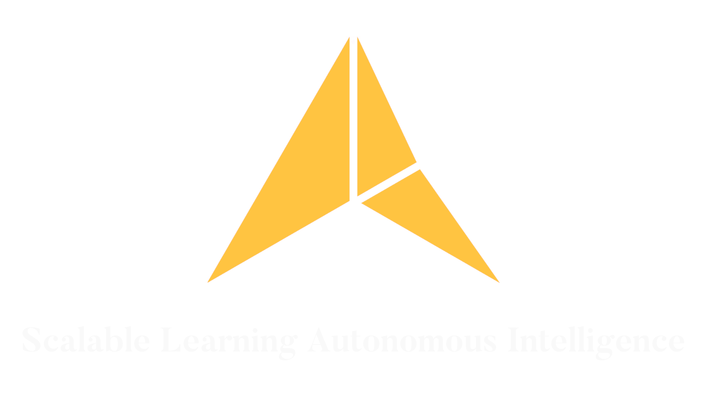
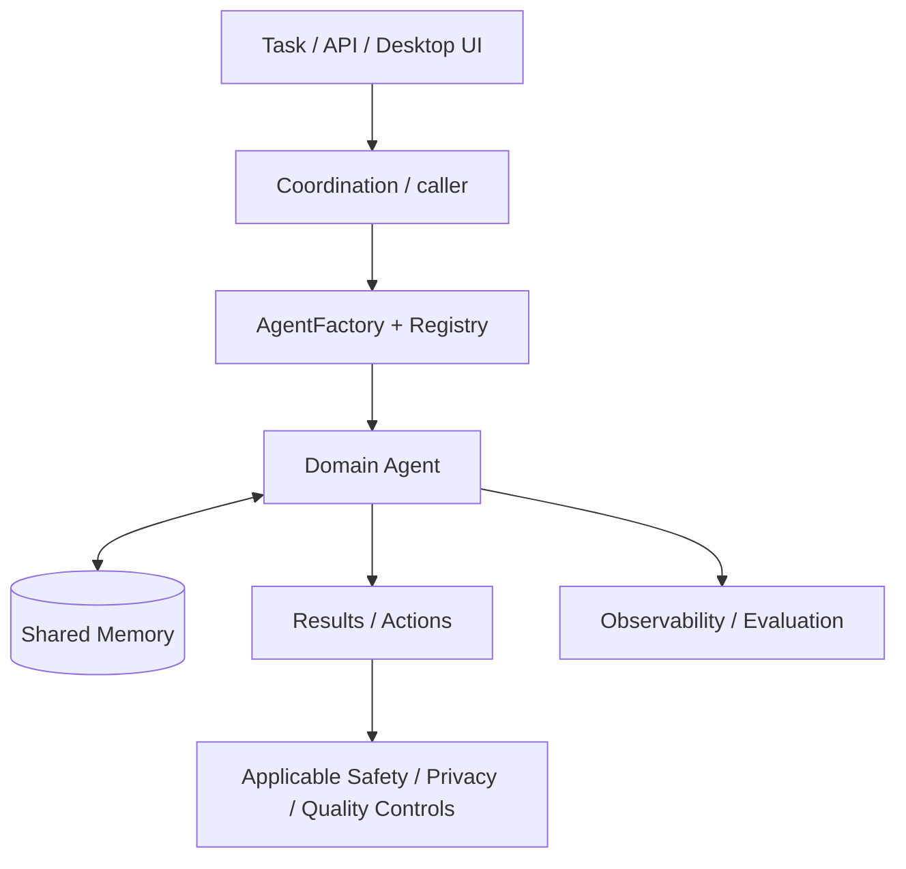

# SLAI v2.3 — Modular Agent Framework



SLAI is an experimental Python multi-agent AI system with a desktop application, domain agents, runtime coordination, monitoring, language-model tooling, and optional integrations. This README documents the **`SLAI-v.2.3` branch**, not `main`. Implemented modules are not, by themselves, evidence of production readiness.

## Architecture

- **`src/agents/base_agent.py`** — shared lifecycle and agent execution infrastructure.
- **`src/agents/agent_factory.py`** — central metadata registration, dependency-aware instantiation, caching, routing, and lifecycle operations.
- **`src/agents/runtime_contracts.py`** — runtime identity, status, and lifecycle contracts.
- **`src/agents/collaborative/`** — shared memory, registry, and coordination infrastructure.
- **`src/agents/orchestrator_agent.py`** — micro-tasks, delegation, and controlled dynamic subagent onboarding.
- **`src/agents/base/configs/agents_config.yaml`** — agent-level runtime configuration, loaded through the existing SLAI configuration infrastructure.
- **`logs/logger.py`** — logging and `PrettyPrinter` conventions.

The factory's default registry includes 26 agent types: adaptive, alignment, browser, evaluation, execution, handler, knowledge, language, learning, network, observability, optimization, orchestrator, perception, planning, privacy, provenance, qnn, quality, reader, reasoning, safety, simulation, spatial, stem, and verification. A separate `CollaborativeAgent` facade is also exposed by the `src.agents` package; its factory registration should be checked against the active revision, not assumed. Public exports, factory registration, and successful runtime construction are three different checks.



This is a conceptual map; exact execution paths depend on the entry point and task. It is **not** a guarantee that every request passes through every control.

```mermaid
flowchart TD
    UserTask[Incoming task / event] --> Factory[AgentFactory]

    Factory --> P[PlanningAgent]
    Factory --> R[ReasoningAgent]
    Factory --> L[LanguageAgent]
    Factory --> S[SafetyAgent]
    Factory --> E[ExecutionAgent]
    Factory --> K[KnowledgeAgent]
    Factory --> V[EvaluationAgent]
    Factory --> A[AlignmentAgent]
    Factory --> C[CollaborativeAgent]
    Factory --> PE[PerceptionAgent]
    Factory --> LE[LearningAgent]
    Factory --> AD[AdaptiveAgent]
    Factory --> H[HandlerAgent]
    Factory --> B[BrowserAgent]
    Factory --> O[ObservabilityAgent]
    Factory --> RE[ReaderAgent]
    Factory --> Q[QualityAgent]
    Factory --> PR[PrivacyAgent]
    Factory --> N[NetworkAgent]

    C <--> Shared[(Collaborative Shared Memory)]
    P <--> Shared
    R <--> Shared
    L <--> Shared
    S <--> Shared
    E <--> Shared
    K <--> Shared
    V <--> Shared
    A <--> Shared
    PE <--> Shared
    LE <--> Shared
    AD <--> Shared
    H <--> Shared
    B <--> Shared
    O <--> Shared
    RE <--> Shared
    Q <--> Shared
    PR <--> Shared
    N <--> Shared

    E --> Actions[Execution actions]
    V --> Reports[Evaluation outputs]
    S --> Guardrails[Safety decisions]
```



## Environment and installation

Python and platform compatibility depend on the selected model and optional feature packages. The project has been developed for Windows and Linux; native dependencies such as CUDA, Selenium browser drivers, PyQt5, and scientific libraries may need platform-specific setup. Prefer an isolated virtual environment.

```powershell
git clone --branch SLAI-v.2.3 https://github.com/The-Outsider-97/SLAI.git
cd SLAI
py -m venv venv
.\venv\Scripts\Activate.ps1
python -m pip install --upgrade pip
```

### LSTP dependency

`requirements.txt` begins with `-e ./model/LSTP`. This is a **local editable dependency**, not a published package that pip can install from an empty folder. The branch includes `model/lstp.lock.json` and `setup_lstp.py` for provisioning a pinned external LSTP checkout. Provision it before a full requirements install:

```powershell
python setup_lstp.py
python -m pip install -r requirements.txt
python run_lstp.py doctor
```

Do not replace the LSTP pin with an unverified moving branch. LSTP supports semantic transport; it does not replace LANTRA, the Language Agent, or execution authorization.

### Linux / WSL

```bash
git clone --branch SLAI-v.2.3 https://github.com/The-Outsider-97/SLAI.git
cd SLAI
python3 -m venv venv
source venv/bin/activate
python -m pip install --upgrade pip
python setup_lstp.py
python -m pip install -r requirements.txt
```

If an optional dependency fails to install, diagnose that dependency and your Python/platform combination. Do not mask broken imports by adding broad `try/except ImportError` fallbacks.

## Run

```powershell
python main.py
```

`main.py` is the desktop UI entry point; it requires the corresponding GUI dependencies and an available display environment. Other commands are task-specific. Use each module's `--help` and documentation before running data-writing or training workflows.

## Quality Memory and persistence

The v2.3 Quality subsystem includes `src/agents/quality/quality_memory.py` and `src/agents/quality/modules/sqlite_store.py`, which provides SQLite WAL transactional persistence. Its configuration is under `src/agents/quality/configs/quality_config.yaml`. The configured SQLite backend expects an existing, successfully migrated database. Migration is deliberately **manual and fail-closed**: back up JSON/JSONL and SQLite files, stop active writers, follow the repository's migration CLI, and verify integrity before enabling SQLite. Do not delete legacy state or assume successful migration merely because SQLite opens.

## Dynamic subagents

`OrchestratorAgent` may create vetted specialist modules under `src/agents/subagents/`. Generated definitions are executable code and must be treated as a trust boundary. Preserve safe module-name validation, collision detection, controlled registrations, and source consistency checks. Do not accept arbitrary Python source from task payloads.

## LANTRA and testing

LANTRA curriculum and training commands are separate from this agent-architecture audit. Use their documented CLI arguments and validate checkpoint/resume behavior before long-running training. Agent changes require LANTRA import and integration smoke tests whenever training or inference paths depend on modified interfaces.

Recommended baseline checks from the repository root:

```powershell
git status --short
git branch --show-current
python -m compileall -q src/agents
python -m pytest --collect-only -q
python -m pytest -q
python -m pytest deployment/test -q
```

The commands above are **verification instructions**, not claims that the suite has passed. Some modules depend on optional heavy libraries or external services; distinguish failures, skips, and environment blockers. For any changed agent, also test construction, actual task execution, shutdown, persistence, and downstream consumers. Use real integration tests in addition to isolated unit tests.

## v2.4 readiness

The v2.3 stabilization goal is a reproducible, tested baseline: verified agent inventory and factory registration; no supported-runtime circular imports; valid configuration; reliable lifecycle and logging; bounded persistence; passing regression tests; and no demonstrated LANTRA/LSTP integration regression. Do not describe v2.4 as ready until those checks actually pass.

## License and contact

> SLAI is an experiment in building safe, scalable, intelligent systems that learn and grow with every user interaction.


## LSTP v0.1 semantic transport

SLAI pins LSTP as an independent Git submodule at:

```text
SLAI/
├── run_lstp.py
└── model/
    └── LSTP/
```

Clone SLAI with submodules:

```bash
git clone --recurse-submodules https://github.com/The-Outsider-97/SLAI.git
cd SLAI
pip install -r requirements.txt
```

For an existing checkout:

```bash
git submodule update --init --recursive
pip install -r requirements.txt
```

Run the real SLAI LanguageAgent through the pinned LSTP v0.1 boundary:

```bash
python run_lstp.py "Summarize the quarterly report." \
  --session-id demo-thread \
  --packet-id demo-packet
```

The launcher performs:

```text
natural language
  -> SLAI LanguageAgent / LinguisticFrame
  -> deterministic frame-to-Octad adapter
  -> LSTP semantic validation
  -> canonical LSTP JSON
```

The language frame never grants execution authority. The adapter emits empty
`Permissions()`; execution/write/commit authorization remains a separate
trusted host decision.

The LSTP gitlink is intentionally pinned to a specific commit. Updating LSTP
inside SLAI is therefore an explicit compatibility change and requires the SLAI
integration smoke tests to pass before the pin moves.
