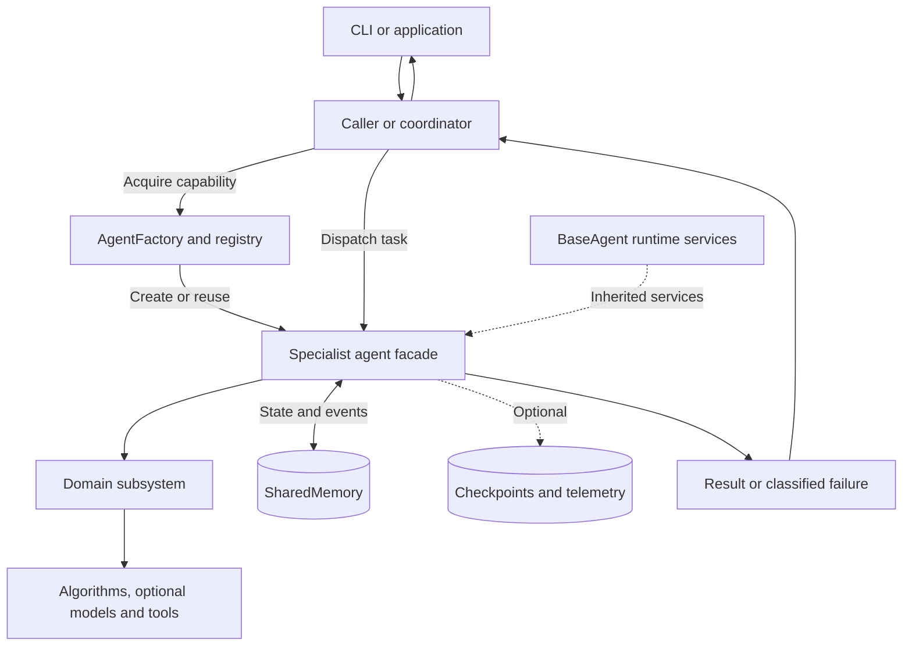

---


# SLAI — Scalable Learning Autonomous Intelligence

SLAI is a Python-based, modular multi-agent artificial intelligence platform for coordinating specialized computational capabilities. Its architecture separates **agent construction**, **task coordination**, **domain execution**, and **shared runtime services**, allowing language processing, reasoning, planning, learning, scientific computation, and operational controls to be developed and evaluated independently.

SLAI is a research and engineering system rather than a claim of artificial general intelligence. The presence of an agent, algorithm, or model loader does not by itself demonstrate trained-model availability, task accuracy, or production readiness. Capabilities depend on the selected configuration, installed dependencies, and available model artifacts.

## Contents

- [Architecture](#architecture)
- [Agents and capabilities](#agents-and-capabilities)
- [System requirements](#system-requirements)
- [Environment and installation](#environment-and-installation)
- [Running SLAI](#running-slai)
- [Trained models and learning](#trained-models-and-learning)
- [Further documentation](#further-documentation)

## Architecture

SLAI uses a **capability-oriented agent architecture**. The [AgentFactory](src/agents/agent_factory.py) maintains registered agent definitions, resolves dependencies and versions, and constructs or reuses managed instances. Each specialist facade defines its domain-specific task boundary. The shared [BaseAgent](src/agents/base_agent.py) supplies execution accounting, runtime status, failure classification, conditional recovery, shared-memory access, and optional checkpoint integration. [Runtime contracts](src/agents/runtime_contracts.py) distinguish an agent definition from a concrete instance and its construction scope.

Coordination is intentionally separate from construction. [CollaborativeAgent](src/agents/collaborative_agent.py) supports policy- and contract-aware task assignment; [OrchestratorAgent](src/agents/orchestrator_agent.py) handles micro-tasks and bounded specialist delegation. Neither is a compulsory intermediate stage for every request. Callers can also acquire and invoke appropriate agents directly.

### Component and execution flow



The diagram shows component relationships, **not a universal sequential pipeline**. In particular, a factory registration does not initialize an agent, and safety, privacy, quality, or evaluation checks are applied according to the relevant caller and agent contracts rather than being guaranteed for every request.

An execution typically involves:

1. **Request reception.** A command-line interface, application, or other caller creates a task using its own input contract.
2. **Capability selection.** The caller or coordinator chooses a suitable specialist. The factory resolves registered metadata, aliases, dependencies, and construction scope when managed acquisition is required.
3. **Initialization and dispatch.** A concrete agent is constructed or reused. The caller invokes its supported operation. The common execution envelope is available through BaseAgent; direct domain methods may follow different accounting paths.
4. **Domain processing.** The specialist applies algorithms, memory, external tools, or configured model inference as needed. Coordination and delegation are optional and task-dependent.
5. **Outcome handling.** The runtime records execution outcomes and may classify failures, apply permitted recovery, or publish observations. It returns a result or a failure condition to the caller.
6. **State and lifecycle.** Shared memory, component-specific persistence, and supported checkpoints can preserve relevant information. Resource release and shutdown remain the responsibility of the owning runtime.

For workflows using the [bounded autonomous control loop](src/agents/autonomous_control_loop.py), the implemented outer sequence is **reason → plan → authorize → execute → evaluate**. This is a particular controlled execution path, not an implicit behavior of all agents.

### Runtime and communication

The factory registry manages **construction metadata and versions**. The separate [collaborative registry and router](src/agents/collaborative/) manage coordination and task assignment. [SharedMemory](src/agents/collaborative/shared_memory.py) provides state-sharing and publication mechanisms; it is not itself a universal task scheduler.

The [runtime lifecycle](src/agents/runtime_contracts.py) distinguishes initializing, active, degraded, stopping, stopped, and failed instances. Agents may use bounded retries, diagnostic records, and conditional persistence. Actual availability still depends on successful construction, dependencies, and the requested operation.

## Agents and capabilities

The [default factory specifications](src/agents/agent_factory.py) register **27 agent types**. The following table describes their primary responsibilities; it does not assert that every optional dependency or trained checkpoint is present at runtime.

| Agent | Primary responsibility |
| --- | --- |
| [Adaptive](src/agents/adaptive_agent.py) | Adaptation strategies, parameter tuning, and recovery-policy selection. |
| [Alignment](src/agents/alignment_agent.py) | Alignment assessments, fairness analysis, and value-related constraints. |
| [Browser](src/agents/browser_agent.py) | Browser operations, content acquisition, and controlled web workflows. |
| [Collaborative](src/agents/collaborative_agent.py) | Task contracts, policy-aware coordination, delegation, and shared-memory operations. |
| [Evaluation](src/agents/evaluation_agent.py) | Evaluation workflows, performance assessment, and structured result reporting. |
| [Execution](src/agents/execution_agent.py) | Validated task and action dispatch, scheduling integration, and recovery. |
| [Handler](src/agents/handler_agent.py) | Failure normalization, retry/escalation handling, and recovery coordination. |
| [Knowledge](src/agents/knowledge_agent.py) | Retrieval, relevance assessment, ontologies, and knowledge synchronization. |
| [Language](src/agents/language_agent.py) | Linguistic analysis, semantic interpretation, generation, and dialogue context. |
| [Learning](src/agents/learning_agent.py) | Selection and coordination of learning strategies and environments. |
| [Network](src/agents/network_agent.py) | Communication transport, routing, reliability, and connection lifecycle. |
| [Observability](src/agents/observability_agent.py) | Tracing, diagnostics, metrics, and runtime performance analysis. |
| [Optimization](src/agents/optimization_agent.py) | Optimization problem formulation and compatible numerical solving. |
| [Orchestrator](src/agents/orchestrator_agent.py) | Micro-task handling, specialist acquisition, and bounded delegation. |
| [Perception](src/agents/perception_agent.py) | Modality processing, representation fusion, and task-specific perception. |
| [Planning](src/agents/planning_agent.py) | Task decomposition, scheduling, plan construction, and replanning. |
| [Privacy](src/agents/privacy_agent.py) | Consent, data minimization, retention, and privacy-risk assessment. |
| [Provenance](src/agents/provenance_agent.py) | Artifact lineage, source records, custody, and reproducibility evidence. |
| [QNN](src/agents/qnn_agent.py) | Parameterized quantum-circuit simulation, evaluation, and training interfaces. |
| [Quality](src/agents/quality_agent.py) | Structural, semantic, statistical, and workflow-quality assessments. |
| [Reader](src/agents/reader_agent.py) | Staged reading, content interpretation, and structured processing. |
| [Reasoning](src/agents/reasoning_agent.py) | Rule-based and probabilistic inference with inspectable reasoning results. |
| [Safety](src/agents/safety_agent.py) | Action-risk checks, security assessments, and compliance-related decisions. |
| [Simulation](src/agents/simulation_agent.py) | Scenario execution, supplied-model rollouts, and sensitivity analysis. |
| [Spatial](src/agents/spatial_agent.py) | Spatial entities, coordinate frames, geometry, and map-related queries. |
| [STEM](src/agents/stem_agent.py) | Mathematical, scientific, and engineering computations. |
| [Verification](src/agents/verification_agent.py) | Formal contracts, constrained checks, and model-verification workflows. |

Agent facades live under [src/agents/](src/agents/), while their corresponding packages provide reusable subsystem logic, configuration, and data contracts. See the [agent architecture reference](src/agents/README.md) for detailed interfaces and lifecycle semantics. Public package exports, factory registration, successful construction, and successful task execution are distinct forms of availability.

## System requirements

Requirements vary with the selected agents, model checkpoints, GUI components, and external integrations. The project has no repository-verified universal minimum RAM, VRAM, or storage benchmark; prescribing fixed hardware numbers would therefore be misleading.

| Component | Minimum or baseline | Additional considerations |
| --- | --- | --- |
| Operating system | Windows or Linux development environment | WSL can be used for Linux workflows on Windows; platform-specific native dependencies may require additional setup. |
| Python | **3.10 or 3.11**, consistent with the declared package range | [Project metadata](pyproject.toml) specifies Python >=3.10 and <3.13. Other versions are not covered by that declaration. |
| Package management | Git, Python virtual environments, and pip | Native build tools may be needed for particular optional packages. |
| Processor | CPU execution for supported non-GPU operations | Exact architectural minimum and throughput have not been established. |
| Memory and storage | Sufficient for the selected dependency set and model artifacts | Transformer checkpoints, scientific packages, caches, and datasets can materially increase both requirements. |
| GPU | Not required for the core agent-management architecture | Neural inference or training may benefit from a compatible accelerator and framework build; CUDA support is platform- and dependency-dependent. |
| Network | Needed for cloning, package installation, and configured remote services | Local inference may be used with available artifacts; model downloads and API-backed features require connectivity. |

The broad [requirements.txt](requirements.txt) includes neural, scientific, browser, GUI, and integration packages. Installing it is more demanding than merely importing the core agent registry. Availability of PyTorch, CUDA, Selenium browser drivers, PyQt5, and some scientific/native libraries depends on the local platform and package versions.

## Environment and installation

Python and platform compatibility depend on the selected model and optional feature packages. The project has been developed for Windows and Linux; native dependencies such as CUDA, Selenium browser drivers, PyQt5, and scientific libraries may need platform-specific setup. Prefer an isolated virtual environment.

### Microsoft Windows (PowerShell)

```powershell
git clone https://github.com/The-Outsider-97/SLAI.git
cd SLAI
py -m venv venv
.\venv\Scripts\Activate.ps1
python -m pip install --upgrade pip
python -m pip install -r requirements.txt
```

### Linux / WSL

```bash
git clone https://github.com/The-Outsider-97/SLAI.git
cd SLAI
python3 -m venv venv
source venv/bin/activate
python -m pip install --upgrade pip
python -m pip install -r requirements.txt
```

These commands clone the repository's default branch. To work with a particular development or release branch, select that Git branch explicitly before installing dependencies.

## Running SLAI

The available root-level conversational entry point is [slailm.py](slailm.py), a LANTRA-first command-line interface that can use selected supporting agents. It requires a compatible LANTRA checkpoint for language generation; optional agents provide supporting capabilities rather than replacing its response model.

From the repository root with the virtual environment active, first inspect available checkpoints:

```bash
python slailm.py --list-checkpoints
```

Start the interactive interface with the configured checkpoint:

```bash
python slailm.py --device cpu
```

If checkpoint discovery does not locate the desired artifact, specify an actual checkpoint file or directory:

```bash
python slailm.py --checkpoint path/to/lantra-checkpoint --device cpu
```

These commands have the same Python invocation on Windows and Linux once the environment has been activated. Use the actual checkpoint path for the selected model; a missing or incompatible artifact prevents inference. Inspect supported flags with:

```bash
python slailm.py --help
```

Agent infrastructure can also be accessed programmatically. This example inspects factory registrations without executing a task:

```python
from src.agents.agent_factory import AgentFactory

factory = AgentFactory()
try:
    print(factory.get_registered_agent_types())
finally:
    factory.shutdown()
```

Constructing and executing a specialist may require further packages, configurations, or model assets. Use its [subsystem documentation](src/agents/README.md) for the request contract rather than assuming that every agent accepts arbitrary text.

### Model sources and configuration

The [Model Hub](src/agents/model_hub.py) supports local model paths and configured Hugging Face artifact resolution. Relevant environment variables include:

| Variable | Purpose |
| --- | --- |
| SLAI_MODEL_SOURCE | Choose local, prefer_hub, or hub resolution. |
| SLAI_MODEL_REPOSITORY | Specify the configured model repository. |
| SLAI_MODEL_REVISION | Select the model-repository revision. |
| SLAI_MODEL_OFFLINE | Restrict hub resolution to already cached files. |

Agent-specific configuration is maintained under [agents_config.yaml](src/agents/base/configs/agents_config.yaml) and the relevant subsystem configuration directories. External provider credentials are optional for features that use those services and must not be committed to source control.

## Trained models and learning

SLAI distinguishes **model implementations**, **training procedures**, **saved artifacts**, and **operational inference**. A model class or training module is not proof that usable weights are present. The system can also perform deterministic or rule-based operations without loading a trained model.

| Model or model family | Associated capability | Repository evidence and availability |
| --- | --- | --- |
| **LANTRA** | [Language](src/agents/language/lantra_runtime.py) | Transformer inference runtime and tokenizer integration are implemented. Actual generation requires a compatible checkpoint discovered locally or through the configured model source. |
| **Reinforcement-learning strategies** | [Learning](src/agents/learning/) | DQN, MAML, RL, and related strategy implementations are present. Trained policy availability depends on the selected environment and saved state. |
| **RelevanceRanker** | [Knowledge](src/agents/knowledge/relevance_ranker.py) | Neural retrieval reranking implementation exists; learned inference requires a compatible trained artifact and feature configuration. |
| **DelegationRanker** | [Collaborative](src/agents/collaborative/delegation_ranker.py) | Learned delegation-scoring implementation exists; availability and policy use depend on the configured model state. |
| **TaskRoutingPolicy** | [Orchestrator routing](src/agents/collaborative/task_routing_policy.py) | Advisory route prediction is implemented with deterministic eligibility constraints and fallback behavior; a validated checkpoint is needed for learned predictions. |
| **PlanSuccessPredictor** | [Planning](src/agents/planning/plan_success_predictor.py) | Offline-trained, advisory plan-outcome predictor; a [serialized model manifest](src/agents/planning/models/plan_success_predictor/manifest.json) is tracked. Use remains configuration- and validation-dependent. |
| **QualityPredictor** | [Quality](src/agents/quality/modules/quality_predictor.py) | Advisory batch-risk model with [serialized model manifest](src/agents/quality/models/quality_predictor/manifest.json); the deterministic quality gate remains authoritative. |
| **QNN parameterized circuit** | [QNN](src/agents/qnn_agent.py) | Numerical circuit simulation and parameter-learning interfaces are implemented; no quantum-hardware execution or quantum speed advantage is implied. Trained state depends on the supplied parameters or checkpoint. |

Some components contain further model interfaces or local artifacts. Consult the agent-specific documentation and configuration before treating them as deployed predictors. In particular, trained-model use is **not a factory-wide requirement**: the factory manages construction, whereas each domain component decides whether inference is available and appropriate.

### Learning and persistence

The [Learning subsystem](src/agents/learning/) provides strategy selection, environment interaction, experience memory, and checkpoint integration. [Adaptive](src/agents/adaptive/) components support feedback-driven adjustment and parameter tuning. Whether an update persists depends on the particular learner and its storage/checkpoint contract.

LANTRA conversational feedback can be retained and used as retrieval context or queued for later training, but ordinary [SLAI-LM](slailm.py) conversation does **not** automatically perform online gradient updates to LANTRA's weights. Similarly, shared-memory writes and cached results should not be confused with model training.

## Further documentation

- [Agent architecture and runtime contracts](src/agents/README.md)
- [Factory construction and lifecycle](src/agents/factory/README.md)
- [BaseAgent infrastructure](src/agents/base/README.md)
- [Collaboration and task routing](src/agents/collaborative/README.md)
- [Language pipeline](src/agents/language/README.md)
- [Learning strategies](src/agents/learning/README.md)
- [QNN capability](src/agents/qnn/README.md)
- [Project dependency declaration](pyproject.toml)

SLAI's implementation is modular and evolves independently across agent and model subsystems. Consult the relevant source code, tests, and component documentation when evaluating a specific capability or deployment configuration.
