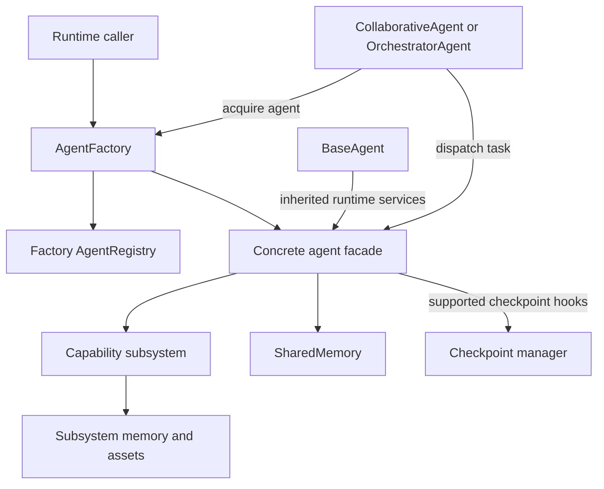
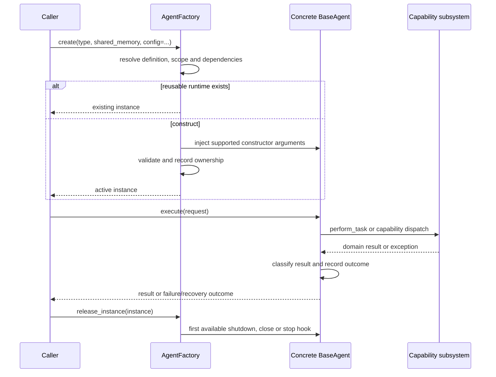

# SLAI Agents Architecture

## Overview

`src/agents/` contains SLAI's agent facades, capability subsystems, construction infrastructure, and coordination runtime. Facades such as `STEMAgent` and `PlanningAgent` expose task interfaces; their sibling packages contain algorithms, data contracts, memory, configuration, and utilities. [Package exports](__init__.py) are resolved lazily to avoid importing every optional dependency when `src.agents` is imported.

The architecture separates capability execution from instance construction and coordination. [AgentFactory](agent_factory.py) registers definitions and constructs managed instances. [BaseAgent](base_agent.py) supplies execution accounting, recovery, shared-memory access, runtime identity, and checkpoint hooks. Concrete agents decide their input schemas and domain semantics. Registration alone does not establish that dependencies, models, or external services are available.

## Architecture



These are construction and service relationships, not a mandatory task pipeline. Tasks do not universally pass through Quality, Planning, Execution, Privacy, and Evaluation in a fixed order. Each coordinator and facade implements its own routing and policy checks.

## Module Structure

| Component | Implementation | Responsibility |
| --- | --- | --- |
| Agent facade | `<name>_agent.py` | Runtime integration and domain-specific task boundary |
| Common runtime | [base_agent.py](base_agent.py), [base/README.md](base/README.md) | Shared configuration, lazy components, execution records, issue handling, checkpoints |
| Runtime contracts | [runtime_contracts.py](runtime_contracts.py) | Definition/instance/scope identity, lifecycle transitions, health and degradation records |
| Construction | [agent_factory.py](agent_factory.py), [factory/README.md](factory/README.md) | Registration, version resolution, import and constructor checks, runtime ownership |
| Coordination | [collaborative/README.md](collaborative/README.md) | Task contracts, policy, routing, collaboration, shared memory |
| Specialist delegation | [orchestrator_agent.py](orchestrator_agent.py) | Validated specialist onboarding, invocation, result caching, ephemeral cleanup |
| Autonomous runtime | [autonomous_control_loop.py](autonomous_control_loop.py) | Control-loop state and agent coordination |

## Agent Subsystem Directory

The identifiers below are the canonical keys in `AgentFactory.DEFAULT_AGENT_SPECS`. Unless stated otherwise, facade classes inherit `BaseAgent`, and therefore integrate with its runtime services. Dependencies listed here are significant source-level integrations, not an exhaustive installation manifest or a guarantee of automatic peer construction.

| Identifier / subsystem | Core implementation | Responsibilities and capabilities | Important integrations | Documentation |
| --- | --- | --- | --- | --- |
| `adaptive` / `adaptive/` | `AdaptiveAgent`, `PolicyManager`, `LearningParameterTuner` | Adaptation, demonstration/feedback learning, recovery strategy ranking | Learning workers, `SLAIEnv` | [Adaptive](adaptive/README.md) |
| `alignment` / `alignment/` | `AlignmentAgent`, `AlignmentSubsystem` | Alignment assessment, fairness and bias analysis, correction decisions | Value embeddings, ethical constraints, counterfactual auditor | [Alignment](alignment/README.md) |
| `browser` / `browser/` | `BrowserAgent`, `BrowserFunctions`, `WorkFlow` | Browser actions, scraping, workflow compilation and execution | Browser driver, security and content modules | [Browser](browser/README.md) |
| `collaborative` / `collaborative/` | `CollaborativeAgent`, `CollaborationManager` | Risk assessment, assignments, policy-controlled delegation | `PolicyEngine`, task contracts, shared memory | [Collaboration](collaborative/README.md) |
| `evaluation` / `evaluators/` | `EvaluationAgent`, evaluator classes | Validation cycles, performance/resource/safety assessments, reports | Safety guard, issue tracking, optional anomaly models | [Evaluation](evaluators/README.md) |
| `execution` / `execution/` | `ExecutionAgent`, `TaskCoordinator` | Action registration, task dispatch, validation and recovery | Planning scheduler, robot interface, optional Adaptive attachment | [Execution](execution/README.md) |
| `handler` / `handler/` | `HandlerAgent`, `IssueHandler` | Failure normalization, recovery, observability and learning-loop handling | Base issue handlers and handler policies | [Handler](handler/README.md) |
| `knowledge` / `knowledge/` | `KnowledgeAgent` | Document retrieval, ontology updates, relevance scoring, knowledge synchronization | Optional Reasoning/Learning attachments, retrieval backends | [Knowledge](knowledge/README.md) |
| `language` / `language/` | `LanguageAgent`, `NLPEngine`, `NLUEngine`, `NLGEngine` | Staged text processing, generation, classification and semantic encoding | Dialogue context, grammar, safety guard, configured language models | [Language](language/README.md) |
| `learning` / `learning/` | `LearningAgent`, `LearningFactory`, `StrategySelector` | Learning strategy dispatch, environment interaction and checkpoint integration | `SLAIEnv`, policy network, recovery system | [Learning](learning/README.md) |
| `network` / `network/` | `NetworkAgent` | Relay, receive, transport health and shutdown | Network adapters, routing, reliability and lifecycle modules | [Source package](network/) — no subsystem README |
| `observability` / `observability/` | `ObservabilityAgent` | Tracing, performance analysis, capacity and diagnostic processing | Observability intelligence and Base execution metrics | [Observability](observability/README.md) |
| `optimization` / `optimization/` | `OptimizationAgent`, `OptimizationSolver` | Canonical problem construction, compatible solver selection, multiobjective workflows | Solver registries, local optimization evidence, NumPy/SciPy | [Optimization](optimization/README.md) |
| `orchestrator` / facade only | `OrchestratorAgent` | Specialist registration and delegation | Factory metadata/cache, validated specialist operations | [Factory](factory/README.md) |
| `perception` / `perception/` | `PerceptionAgent`, `PerceptionFusion`, `PerceptionTrainer` | Modality processing, fusion, task heads, training and weight loading | Encoders/decoders, learning objectives, checkpoint manager | [Perception](perception/README.md) |
| `planning` / `planning/` | `PlanningAgent`, `ProbabilisticPlanner`, `PlanningExecutor` | Task decomposition, plan generation, scheduling and replanning | Heuristics, resource monitor, safety planning, shared memory | [Planning](planning/README.md) |
| `privacy` / `privacy/` | `PrivacyAgent` | Consent, purpose binding, minimization, retention and privacy assessment | Flow/risk/exposure analysis and auditability | [Privacy](privacy/README.md) |
| `provenance` / `provenance/` | `ProvenanceAgent`, `ProvenanceStore` | Source/artifact registration, lineage, custody and reproducibility reports | Lineage graph, checkpoint records, provenance memory | [Provenance](provenance/README.md) |
| `qnn` / `qnn/` | `QNNAgent`, `StateVectorCircuit` | State-vector circuit evaluation, parameter training and state serialization | Quantum encoding/policy modules, checkpoint hooks | [QNN](qnn/README.md) |
| `quality` / `quality/` | `QualityAgent`, `QualityMemory` | Structural, semantic, statistical and relationship quality assessment | Baseline governance, evidence calibration, workflow control | [Quality](quality/README.md) |
| `reader` / `reader/` | `ReaderAgent` | Structured reading plans and staged content processing | Reader subsystem contracts, stage results and summaries | [Reader](reader/README.md) |
| `reasoning` / `reasoning/` | `ReasoningAgent`, `RuleEngine` | Facts/rules, forward chaining, probabilistic queries and reasoning traces | Validation engine, probabilistic models, shared memory | [Reasoning](reasoning/README.md) |
| `safety` / `safety/` | `SafetyAgent` | Action validation, risk/security assessment, compliance and incident handling | Safety guard, cyber safety, reward model, STPA | [Safety](safety/README.md) |
| `simulation` / `simulation/` | `SimulationAgent`, `RolloutEngine`, `ScenarioEngine` | Supplied-model rollouts, scenarios, Monte Carlo and sensitivity analysis | Injected model callbacks, simulation memory, NumPy | [Simulation](simulation/README.md) |
| `spatial` / `spatial/` | `SpatialAgent`, `SpatialCompute`, `SpatialQueries` | Entities, frame transforms, geometry, indexing, occupancy and map alignment | Spatial memory, collision/topology modules, NumPy | [Spatial](spatial/README.md) |
| `stem` / `stem/` | `STEMAgent`, scientific domain classes | Explicitly dispatched mathematical, scientific and engineering calculations | Base scientific engines, units, numerical methods, local cache | [STEM](stem/README.md) |
| `verification` / `verification/` | `VerificationAgent`, formal verification components | Formal contracts, solver-backed checks and finite-state model checking | Backend registry, verification results/memory, optional SMT backend | [Verification](verification/README.md) |


## Construction and Runtime Identity

`AgentFactory(config=None)` loads [agents_config.yaml](base/configs/agents_config.yaml), overlays factory settings, and normally registers the static specifications without importing every facade. Configured aliases normalize names; opt-in discovery imports explicitly named packages and inspects exported `BaseAgent` subclasses. Discovery is not recursive filesystem scanning.

`create(agent_type, shared_memory=None, **kwargs)` resolves metadata and version, combines the `<name>_agent` section with a runtime `config` override, and derives a scope from shared memory, resolved configuration, and constructor context. It checks reusable runtime records before creating dependencies and importing the class. Constructor arguments are selected from its signature; successful instances must satisfy the configured action/runtime contracts.

Identity consists of:

- `definition_id`: registered `name@version`.
- `instance_id`: unique constructed runtime identity.
- `scope_id`: non-secret discriminator for construction context.

Aliases share canonical definitions; different versions and scopes remain distinct. `active_agents` is a compatibility view by type, not the complete ownership ledger. Use `get_active_instance_identities()` and `snapshot()` to inspect managed instances. Factory defaults and lifecycle details are documented in [Factory](factory/README.md).

## Execution Lifecycle



`BaseAgent.execute()` requires an active or degraded runtime. It tracks execution, invokes the capability, classifies returned failures, and records outcomes. Retries after exceptions require declared idempotency or supported idempotency keys. Recovery is conditional; an echoed input is not automatically a valid recovery. Optional accounting failures are recorded as degradation rather than rerunning a successful capability.

`perform_task()` is the domain dispatch boundary. Calling it directly bypasses the common execution/retry envelope. Some facades implement `predict()` and `act()` as compatibility routes; those names do not imply learned inference or action selection. Simulation and Spatial explicitly expose computation through those routes without choosing actions.

Persistence is component-specific. SharedMemory, local result histories, deterministic caches, trained model state, and central checkpoints serve different purposes. Checkpoint support is declared per agent and requires the checkpoint-manager contract when enabled. Factory release does not itself guarantee that every subsystem saves state or closes caller-owned resources.

## Coordination and Shared Infrastructure

[CollaborativeAgent](collaborative_agent.py) combines risk assessment, task contracts, policy, and `CollaborationManager`. The collaboration package's registry/router serves task assignment; it is distinct from the factory's `AgentRegistry`, which stores construction metadata and versions. SharedMemory supplies cross-agent state and publication APIs, not a universal task scheduler.

[OrchestratorAgent](orchestrator_agent.py) acquires registered agents through the factory and invokes the requested callable with mapping parameters. New generated specialties require a validated executable specification. Generation is restricted to the operations in [factory/operations.py](factory/operations.py); it is not arbitrary code synthesis. Generated specialists may be acquired as ephemeral instances and released by exact identity. Shared core agents remain factory-owned.

Integrations are explicit and conditional: Knowledge exposes Reasoning/Learning attachment methods; Execution imports the planning scheduler and permits Adaptive/robot attachments; Language and Evaluation use safety components. Learning owns learning strategy selection, while Perception supplies training/weight-loading interfaces. There is no factory-wide requirement that every agent load a trained model. The four quantitative subsystems documented here compute or execute supplied models; their APIs do not establish that a trained artifact has been deployed.

## Configuration and Assets

Agent orchestration settings live in [base/configs/agents_config.yaml](base/configs/agents_config.yaml). Subsystem settings live in each package's `configs/` and are loaded through its configuration helpers. A factory `config={...}` override for an agent is not an arbitrary override of its numerical solver or geometry configuration.

The checked-in factory setting `default_version` is `2.2.0`, while the package marker is `2.3.0`. Registry identities follow resolved metadata, not the package marker. Inspect the registry instead of hard-coding a version from a release name.

## Minimal Usage

Run from the repository root in an environment with SLAI's existing dependencies. This example inspects definitions without constructing capability agents:

```python
from src.agents.agent_factory import AgentFactory

factory = AgentFactory()
try:
    names = factory.get_registered_agent_types()
    assert {"stem", "spatial", "simulation", "optimization"}.issubset(names)
    print(factory.registry.get("stem").import_path)
finally:
    factory.shutdown()
```

For task execution, use the request contract and examples in the target subsystem README. Runtime construction can allocate memory, initialize components, or access configured assets; it is not equivalent to inspecting a registered definition.

## Development and Verification

1. Locate the facade and its sibling subsystem, then inspect `perform_task()`, constructor parameters, configuration ownership, and result semantics.
2. Implement an executable capability on a `BaseAgent` subclass. Keep domain results distinct from telemetry and persistence failures.
3. Add construction metadata through `register_agent(AgentMetaData(...), overwrite=False)` or a deliberate default-specification change. Define dependencies and required constructor parameters explicitly.
4. Add supported configuration and exports where appropriate. Discovery only sees classes exported by the packages it imports.
5. Check action contracts, repeated construction/reuse, invalid inputs, failure classification, exact-instance cleanup, and checkpoint behavior where supported.
6. Document the facade/subsystem boundary and update this directory when adding a registered agent.

This checkout has no dedicated `tests/` suite for the four quantitative facades or factory. Several modules contain `__main__` demonstrations; inspect their side effects before running them. Syntax checks and example execution do not replace numerical validation, backend compatibility tests, or full runtime integration testing.

## Related Documentation

- [Factory construction and lifecycle](factory/README.md)
- [Base runtime](base/README.md)
- [Collaboration](collaborative/README.md)
