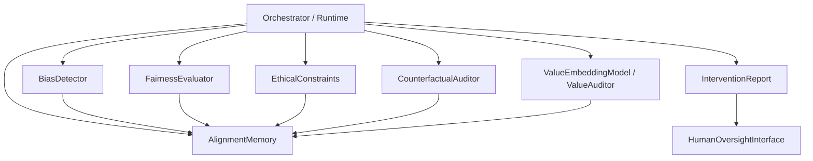

# Alignment Agent Subsystem (`src/agents/alignment`)

This directory contains SLAI’s alignment and governance subsystem: reusable components for bias/fairness auditing, ethical rule enforcement, causal counterfactual checks, value-model auditing, intervention reporting, and human-oversight orchestration.

Unlike a single monolithic `AlignmentAgent` class, this package is organized as composable modules that can be orchestrated by a higher-level runtime.

---

## Scope and responsibilities

The alignment subsystem is responsible for:

- persistent alignment telemetry and drift tracking (`alignment_memory.py`)
- group/metric bias detection with statistical testing (`bias_detection.py`)
- fairness evaluation across group and individual perspectives (`fairness_evaluator.py`)
- policy and constitutional rule governance (`ethical_constraints.py`)
- causal and counterfactual fairness auditing (`counterfactual_auditor.py`, `auditors/`)
- value embedding, preference modeling, and value-policy scoring (`value_embedding_model.py`)
- structured intervention reports and human review workflows (`utils/intervention_report.py`, `utils/human_oversight.py`)
- typed error taxonomy and config/validation helpers (`utils/alignment_errors.py`, `utils/alignment_helpers.py`, `utils/config_loader.py`)

---

## Directory structure

```text
alignment/
├── __init__.py
├── README.md
├── alignment_memory.py
├── assessment.py
├── runtime.py
├── learned_models.py
├── train_models.py
├── bias_detection.py
├── counterfactual_auditor.py
├── ethical_constraints.py
├── fairness_evaluator.py
├── value_embedding_model.py
├── configs/
│   └── alignment_config.yaml
├── auditors/
│   ├── __init__.py
│   ├── TetradRunner.java
│   ├── causal_model.py
│   └── fairness_metrics.py
├── templates/
│   ├── capability.json
│   ├── constitutional_rules_privacy.json
│   ├── constitutional_rules_transparency.json
│   ├── distribution.json
│   ├── physical_harm.json
│   ├── procedure.json
│   ├── psychological_harm.json
│   └── un_human_rights.json
└── utils/
    ├── CHANNELS.md
    ├── __init__.py
    ├── alignment_errors.py
    ├── alignment_helpers.py
    ├── config_loader.py
    ├── human_oversight.py
    └── intervention_report.py
```

---

## Subsystem interaction diagram



---

## Core subsystem components

### 1) `AlignmentMemory`
Persistent memory layer for alignment events and outcomes.

Key functions:
- maintains alignment logs, outcome history, and context registry
- tracks intervention effects and model history
- supports concept drift scoring and replay buffers
- validates memory configuration and retention settings

Use this as the common evidence store consumed by bias/fairness/ethics/counterfactual modules.

### 2) `BiasDetector`
Group and intersectional bias telemetry engine.

Key functions:
- computes fairness-oriented disparity metrics
- performs statistical significance testing and corrections
- tracks historical bias snapshots over time
- optionally logs to `AlignmentMemory`

### 3) `FairnessEvaluator`
Formal fairness evaluation across both population-level and instance-level lenses.

Key functions:
- group metrics (e.g., statistical parity, disparate impact)
- individual consistency and neighborhood-based analyses
- configurable thresholds, bootstrap/permutation sampling
- historical logging and memory integration controls

### 4) `EthicalConstraints`
Ethical governance/control-plane module.

Key functions:
- loads and enforces safety/fairness/constitutional rule bundles
- tracks constraint priorities, severities, and adaptation controls
- produces audit-friendly records for downstream review
- integrates with memory for persistent governance telemetry

### 5) `CounterfactualAuditor`
Causal intervention and sensitivity analysis layer.

Key functions:
- generates counterfactual scenarios per sensitive attribute
- runs counterfactual prediction paths with configurable strategies
- evaluates fairness thresholds under interventions
- integrates with `auditors/causal_model.py` and `auditors/fairness_metrics.py`

### 6) `ValueEmbeddingModel` (+ dataset/trainer/auditor)
Neural value-modeling stack for alignment scoring.

Key functions:
- encodes value text, cultural context, and policy parameters
- estimates policy-value compatibility and preference alignment
- supports training/evaluation helpers (`ValueDataset`, `ValueTrainer`, `ValueAuditor`)
- can emit memory-compatible audit telemetry

### 7) Utilities and reporting
- `alignment_errors.py`: typed exception hierarchy for alignment failures
- `alignment_helpers.py`: normalization, coercion, and validation helpers
- `config_loader.py`: centralized config loading
- `human_oversight.py`: async human review flows, channels, persistence, and auth hooks
- `intervention_report.py`: structured report schema for interventions

---

## Integration pattern (recommended)

A typical orchestration flow for this subsystem:

1. initialize shared `AlignmentMemory`
2. run `BiasDetector` and `FairnessEvaluator` on decision outputs
3. evaluate policy/rule constraints through `EthicalConstraints`
4. trigger `CounterfactualAuditor` for high-risk or ambiguous decisions
5. optionally score value congruence using `ValueEmbeddingModel` / `ValueAuditor`
6. compile findings into intervention reports and escalate through `HumanOversightInterface` when required

This sequence is intentionally modular so product-specific orchestrators can adapt ordering and thresholds.

---

## Minimal usage example

```python
from src.agents.alignment import AlignmentMemory, BiasDetector, FairnessEvaluator, EthicalConstraints

memory = AlignmentMemory()
bias = BiasDetector(alignment_memory=memory)
fairness = FairnessEvaluator()
ethics = EthicalConstraints()

# In your orchestrator:
# 1) bias_report = bias.detect_bias(...)
# 2) fairness_report = fairness.evaluate_fairness(...)
# 3) ethics_report = ethics.evaluate_constraints(...)
# 4) persist/aggregate and escalate if needed
```

---


## Additional utility documentation

For channel-specific human-oversight integration details, see:

- [`utils/CHANNELS.md`](./utils/CHANNELS.md)

---

## Notes for maintainers

- Keep config-backed defaults in sync with `configs/alignment_config.yaml`.
- Prefer adding reusable primitives here rather than embedding governance logic directly into role-specific agents.
- When adding new auditors or templates, update both this README and `__init__.py` exports (where applicable) to preserve discoverability.

---

## SLAI v2.4 optional learned alignment models

The v2.4 optional model path builds on the existing ValueEmbeddingModel
text feature extraction, text projection, and alignment scoring head. It does
not introduce a separate memory store, policy engine, or model registry.

- **RepresentationEncoder** learns normalized embeddings from reviewed
  value/action pairs using contrastive loss.
- **ValueAlignmentScorer** learns a supervised compatibility head using the
  encoder's representations. Its score is **not calibrated** and grants no
  authority to act.
- **AlignmentModelBundle** verifies tensor-only checkpoint SHA-256 digests,
  model schema, feature configuration, and explicit operator approval for active
  mode. Checkpoints are loaded with torch's weights-only deserialization.
- **AlignmentSubsystem** consumes an explicit task payload field named
  learned_alignment; no implicit interpretation of arbitrary strings or
  automatic authorization is performed.

Agent-level configuration is in src/agents/base/configs/agents_config.yaml:
runtime.learned_model_mode = disabled | shadow | advisory | active and
runtime.learned_model_artifact_dir = path/to/a/versioned/artifact/directory.
For active inference, runtime.learned_model_manifest_sha256 must pin the
approved manifest.json byte-for-byte; unpinned active models are rejected.
The default is **disabled**.

Shadow and advisory modes produce component diagnostics but do not add scored
alignment evidence. Active mode requires an operator-approved manifest and
produces soft *preference* evidence only. Existing mandatory alignment
constraint violations remain non-overridable by model evidence.

Example explicit assessment input:

    {
      "learned_alignment": {
        "value_text": "Respect the user's informed preference",
        "action_text": "Ask for permission before sharing their information"
      }
    }

This example does not modify constraint enforcement. Untrusted task payloads
cannot disable the Alignment-owned dynamic constraint check; this control is
configured by AlignmentAgent, alongside independent Safety and Privacy gates.

### Offline training

Training requires a **reviewed** JSONL dataset whose rows contain:
group_id, source_id, value_text, action_text and label (0 or 1).
group_id identifies independent examples so no group crosses
training/validation/test partitions. A separate JSON metadata file must
provide license, annotation_guidelines and source_description.

    python -m src.agents.alignment.train_models \
        --data path/to/reviewed_pairs.jsonl \
        --metadata path/to/dataset_metadata.json \
        --out data/models/alignment/reviewed_v1

The trainer uses deterministic seeds, grouped holdouts, a contrastive encoder
objective, and independently trained supervised scorer weights. It writes
representation_encoder.pt, value_alignment_scorer.pt, and manifest.json.
The manifest records dataset fingerprints, held-out results, architecture and
feature schema. Training always writes approved=false; results are **not**
production authorization.

The unapproved checkpoint may be evaluated in shadow/advisory mode. Promotion
to active is a separate authorized release operation requiring independent
data review and evaluation. Setting approved=true is a configuration trust decision by the operator, not
an automated proof of alignment quality. After independent approval, compute
the exact SHA-256 of manifest.json and configure the trusted digest in
agents_config.yaml (or its authorized deployment override). Any later
manifest/checkpoint change must require a new reviewed digest.

### Reproducibility / legacy checkpoints

ValueEmbeddingModel previously used Python's process-randomized hash() for
token features. New models default to text_hash_strategy=blake2b_v1.
Old checkpoints require explicitly setting
text_hash_strategy=legacy_python_hash_v0 and retaining the original
PYTHONHASHSEED, when known. They are NOT assumed compatible with new models;
retraining with the stable schema is preferable.

### Known limitations and release gates

- No independently reviewed alignment dataset or approved checkpoint ships
  in this code change. The test-suite synthetic pairs only validate plumbing.
- The scorer's outputs are uncalibrated; no probabilistic confidence claims.
- This model path does not replace existing constitutional constraints,
  Safety/Privacy enforcement, human oversight, or formal evaluation.
- Production promotion requires independent labeled evaluation (including
  harmful disagreement cases), successful CI, secure artifact storage,
  operational latency/memory profiling, and a documented approval process.
- The underlying existing alignment subsystem is much larger than these
  changes; this contribution does not claim a completed whole-subsystem
  security and performance certification.


### Legacy AlignmentMemory checkpoint security

AlignmentMemory previously loaded pickle checkpoints and joblib causal models
without authentication. These formats permit arbitrary Python code execution
during deserialization. Loading now requires **trusted SHA-256 digests provided
independently of the binary**:

    memory.load_model(path, trusted_sha256=independently_verified_model_digest)
    memory.load_checkpoint(
        path,
        trusted_sha256=independently_verified_checkpoint_digest,
        trusted_model_sha256=independently_verified_model_digest,
    )

Do not derive these trust decisions solely from a hash stored beside an
untrusted file. Existing save methods continue writing legacy files to
preserve on-disk compatibility; unpinned loads now fail closed. Only load
legacy files from a trusted source in a trusted Python environment. A
future migration to a fully non-executable checkpoint format is still
required before accepting arbitrary imported checkpoints.
