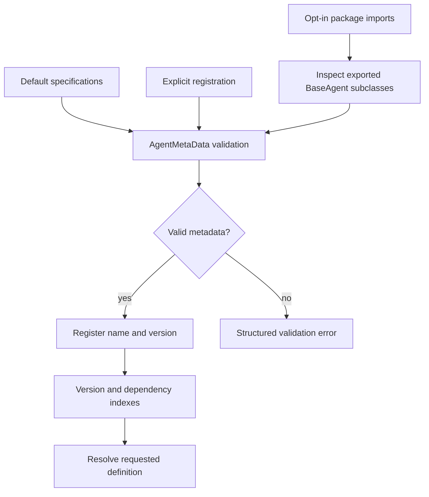
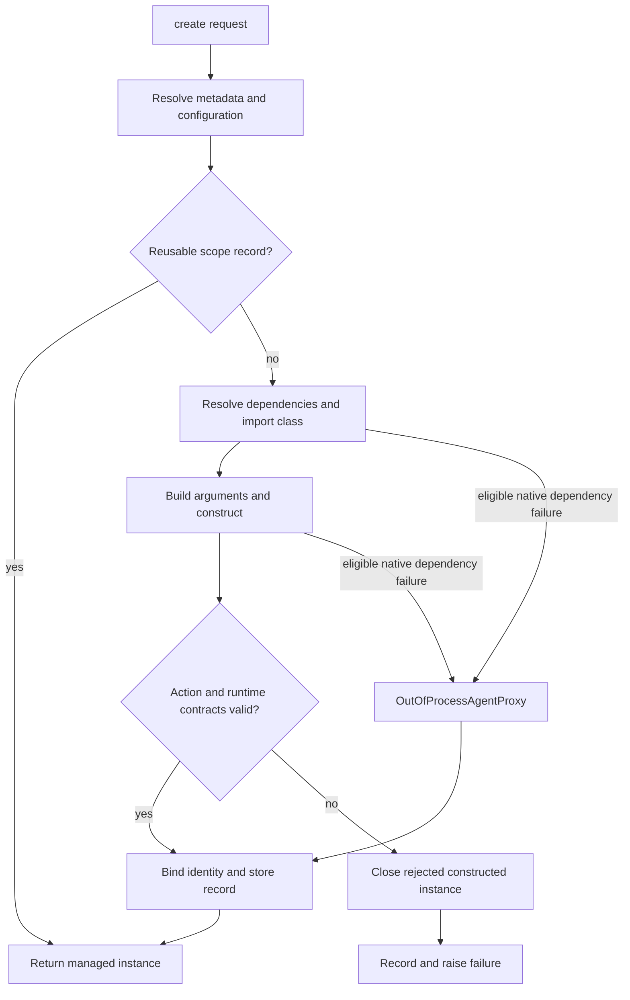

# Factory Module

## Overview

The factory infrastructure registers agent definitions, resolves versions and dependencies, constructs compatible runtime instances, and tracks ownership and health. The public facade is [AgentFactory](../agent_factory.py), outside this directory. This package supplies metadata, registries, caching, diagnostics, metric adaptation, isolation helpers, and validated specialist operations.

A definition is not a live instance. `AgentMetaData.identity` identifies `name@version`; the runtime adds a unique instance ID and a construction scope. The factory's registry is separate from the collaboration subsystem's task-routing registry.

## Module Structure

| Module | Components | Runtime role |
| --- | --- | --- |
| [../agent_factory.py](../agent_factory.py) | `AgentFactory`, `AgentFactoryConfig`, `ManagedAgentRecord`, `AgentCreationRecord` | Public construction, registration, routing, inspection and release APIs |
| [agent_meta_data.py](agent_meta_data.py) | `AgentMetaData`, `AgentRegistry` | Metadata validation, version/default indexes and dependency ordering |
| [factory_cache.py](factory_cache.py) | `FactoryCache` | Configurable bounded caching and cache statistics |
| [factory_obs.py](factory_obs.py) | `FactoryObservability`, `TimingStats`, `EventRecord` | Counters, gauges, timings, bounded events and health snapshots |
| [metrics_adapter.py](metrics_adapter.py) | `MetricsAdapter`, `PIDState`, `AdaptationRecord` | Fairness/performance/bias errors, PID adjustment, bounded adaptation history |
| [out_of_process_agent.py](out_of_process_agent.py) | `OutOfProcessAgentProxy` | Subprocess transport for supported fallback calls |
| [remote_worker.py](remote_worker.py) | `RemoteWorker`, request/configuration classes | Parse, construct, invoke and encode a worker request |
| [operations.py](operations.py) | `validate_specialist_spec`, specialist execution functions | Bounded `numeric_summary` and `project_records` behavior for generated specialists |
| [orchestration.py](orchestration.py) | Routing/adaptation data contracts | Supporting policy and proposal representations; presence does not imply every type is wired into `AgentFactory` |
| [runtime_ownership.py](runtime_ownership.py) | Ownership and failure-circuit primitives | Reusable runtime helpers; the facade's current create path uses its own managed records and unavailable map |
| [utils/factory_helpers.py](utils/factory_helpers.py) | Validation, normalization and serialization helpers | Metadata, names, class paths, constructor and error-context checks |
| [utils/factory_errors.py](utils/factory_errors.py) | `FactoryError` hierarchy | Structured errors with context, causes and retryability |
| [utils/config_loader.py](utils/config_loader.py) | Configuration accessors | Factory-package settings from [factory_config.yaml](configs/factory_config.yaml) |

## Registration and Discovery

`AgentFactory()` normally calls `register_default_agents()`. Static specifications in `DEFAULT_AGENT_SPECS` map canonical names to module/class pairs. Configured `agent_specs` or `default_agent_specs` can overlay these specifications. Registration creates metadata; target facade imports occur during resolution/construction or explicit diagnostics.

`AgentMetaData(name, class_name, module_path, required_params=(), version=None, ...)` validates required fields, names, class/module paths, version format, dependency names and lifecycle. Validation policy comes from `agent_meta` in the factory package configuration. Its `config` parameter controls metadata validation configuration; it is not the configuration passed to the agent constructor.

`register_agent(metadata, overwrite=True)` registers by name/version. Use `overwrite=False` to reject replacement. Successful replacement releases managed instances of the previous definition and retires its metadata. The registry maintains version-specific entries, a default-version view, and dependency indexes; graph checks and rollback protect registry updates. Missing dependencies and cycles are subject to registry policy and dependency resolution checks.

`discover_agents(packages=None)` imports the explicitly supplied/configured packages and inspects their members for `BaseAgent` subclasses. It derives names by removing `Agent` and lowercasing the class name. It does not recursively walk package directories. Discovery is disabled by default because imports can require optional dependencies; package import errors can propagate.



## Construction and Configuration

The public interface is `create(agent_type, shared_memory=None, **kwargs)`. `create_agent()` and `get_agent()` delegate to it. Special arguments are `version`, `config`, and the boolean `_ephemeral`; remaining arguments are considered for constructor injection.

1. Normalize the identifier through aliases and resolve the requested/default registered version.
2. Load `<canonical_name>_agent` from the factory's global configuration and shallow-overlay the runtime `config` mapping when overrides are allowed.
3. Derive a scope from shared memory, resolved agent configuration, and constructor context. Check a live reusable managed record for the definition/scope.
4. Check availability and recursively construct declared dependencies in dependency order when enabled.
5. Import and resolve the class; optionally require a `BaseAgent` subclass.
6. Inspect the constructor. Supply `shared_memory`, `agent_factory`, and `config` only when those parameters are declared. Validate metadata-declared required parameters.
7. Construct, check the action/runtime surface, bind identity, and record the active instance. A rejected constructed instance is offered the first available `shutdown`, `close`, or `stop` hook.

Dependency creation does not automatically inject every dependency as a named constructor argument. Unsupported extra constructor keywords are skipped and logged by default; enabling `allow_unknown_constructor_kwargs` passes them through and can expose constructor `TypeError` failures.



### Configuration Ownership

| Location / argument | Accepted contract and behavior |
| --- | --- |
| [agents_config.yaml](../base/configs/agents_config.yaml), `agent_factory` | Factory facade policy; `AgentFactory(config=None)` accepts a mapping of overrides, including a nested `agent_factory` mapping |
| `<name>_agent` sections | Facade-specific policy such as publication, dispatch and retention |
| `create(..., config=mapping)` | Shallow overlay of the resolved facade section; rejected when runtime overrides are disabled |
| [factory_config.yaml](configs/factory_config.yaml) | Metadata/registry, cache, observability, metrics, proxy, worker and specialist-operation settings |
| Subsystem `configs/` | Numerical/domain policies owned by the subsystem, not arbitrary factory constructor settings |

`AgentFactoryConfig.from_mapping()` requires actual booleans for boolean flags; strings such as `"false"` are invalid. String-sequence settings accept a single string or a sequence of nonempty strings. `creation_history_size` is converted with `int()` then checked positive. Unknown mapping keys are not evidence of an implemented policy: only settings read by the facade affect its behavior.

| Facade settings | Code defaults | Effect |
| --- | --- | --- |
| `enabled`, `auto_register_default_agents` | `True`, `True` | Factory availability and default registration |
| `strict_base_agent_subclass`, `enforce_runtime_contracts` | `False`, `True` | Class inheritance and runtime-surface enforcement |
| `use_instance_cache`, `cache_agent_instances` | `True`, `True` | Reuse lookup and cache policy; managed records remain ownership authority |
| `cache_imports`, `cache_constructor_signatures` | `True`, `True` | Import/signature reuse |
| `allow_runtime_config_override`, `allow_unknown_constructor_kwargs` | `True`, `False` | Constructor configuration and keyword handling |
| `create_dependencies` | `True` | Recursive construction of registered dependencies |
| `block_torch_required_when_unavailable` | `True` | Gate profiles requiring an unavailable torch runtime |
| `enable_out_of_process_fallback` | `True` | Permit eligible native-dependency fallback, subject to agent allowlist and error patterns |
| `discovery_enabled`, `discovery_packages` | `False`, empty | Explicit import-based discovery |
| `record_creation_history`, `creation_history_size` | `True`, `100` | Bounded construction records |
| `publish_observability_events` | `True` | Factory event publication |
| `diagnostics_import_check`, `diagnostics_constructor_check` | `True`, `True` | Inspection checks; these can import modules |

The checked-in YAML also contains circuit/routing/proposal settings beyond `AgentFactoryConfig`. Do not assume they are enforced merely because corresponding helper modules or YAML keys exist; inspect the specific facade method consuming them.

## Instance Ownership and Cleanup

Managed runtime identity separates `definition_id`, `instance_id`, and `scope_id`. Normal repeated requests can reuse the same active instance within a scope. `_ephemeral=True` bypasses reuse and marks the acquired instance for exact-instance recycling. It must be a real boolean.

| API | Scope |
| --- | --- |
| `release_instance(instance, ephemeral_only=False)` | Release exactly the supplied factory-owned object; optional ephemeral-only guard |
| `release(agent_type, version=None)` | Administrative release of all matching type/version instances across scopes |
| `unregister_agent(agent_type, version=None)` | Remove definition, release its instances and retire metadata |
| `clear_active_agents()` | Release all managed runtime records |
| `shutdown()` | Stop factory, release agents, clear cache and record shutdown; repeated stopped shutdown returns immediately |

Release transitions through stopping and stopped, invokes only the first available shutdown/close/stop hook, and removes the managed record even if cleanup fails. Failures remain observable; shutdown raises an aggregate `RuntimeError` when cleanup errors were collected. There is no guarantee of domain-specific persistence in a generic release hook.

If a constructor raises before returning an object, the factory has no completed instance to close. Dependencies created before a later construction failure are not transactionally rolled back. Constructors must therefore manage partially allocated resources themselves.

## Dynamic Specialists

Dynamic generation belongs to [OrchestratorAgent](../orchestrator_agent.py), not `AgentFactory.create()`. The orchestrator initializes `src/agents/subagents/` and its configuration workspace when constructed. Generated modules use a fixed validated template and delegate executable behavior to [operations.py](operations.py).

Unknown specialties require `specialist_spec`; supported operations are `numeric_summary` and `project_records`. Generation policy must enable creation. Module-name safety, collision checks, maximum definitions, existing-spec equality, subclass checks and callable task handling are validated before registration. Core agent definitions cannot be replaced through specialist task payloads. Custom implementation paths must be registered directly through the factory.

When `ttl_recycling` is enabled, delegation to a non-core specialist uses `_ephemeral=True` and releases that exact instance in `finally`. Core agents remain reusable. Instance release does not remove the generated source file or definition. Failed generation/registration must not be described as a transactional rollback of all filesystem changes.

## Metrics, Routing and Isolation

`MetricsAdapter.process_metrics()` derives errors and bounded PID adjustments for fairness, performance and bias. `process_metrics_result()` retains a structured adaptation record; `update_factory_config()` applies supported adjustments to factory metadata/runtime targets. `run_adaptation_cycle()` computes adjustments and calls the adapter update method immediately; the checked-in `adaptation_auto_apply` key does not turn this implementation into a proposal-only workflow. `route_agent()` is the facade routing entry point. Their existence does not establish that every routing/proposal primitive in this package is active.

Out-of-process fallback is conditional on enabled policy, allowed agent types and recognized native-dependency failures. `OutOfProcessAgentProxy` invokes the configured worker transport; `RemoteWorker` validates payloads and resolves supported constructors/methods. This is process isolation, not a replacement for missing mathematical backends or a general security sandbox. Remote invocation has serialization and runtime-configuration constraints; it must not be assumed equivalent to sharing arbitrary in-process objects.

## Error Handling and Diagnostics

Unknown names/versions, invalid metadata, dependency problems, class resolution failures, missing required parameters and runtime-contract failures have structured factory errors. Constructor `TypeError` is wrapped as `AgentConstructionError`; unexpected initialization exceptions become `AgentInitializationError`. Nonretryable creation failures can mark a definition/scope unavailable until reset. `reset_unavailable(agent_type=None, version=None)` clears those records; it does not repair the underlying dependency or implementation.

Use `inspect_registered_agents(import_check=False, constructor_check=False)` for metadata-oriented inspection, `get_agent_dependency_report()` for profile/probe information, and `health_check()` or `snapshot()` for runtime diagnostics. Optional cache/telemetry failures are recorded as degradation where guarded; they are not proof that capability execution failed.

## Minimal Usage

Inspect definitions without constructing a domain agent:

```python
from src.agents.agent_factory import AgentFactory

factory = AgentFactory()
try:
    definition = factory.registry.get("simulation")
    print(definition.identity, definition.import_path)
    print(factory.get_registered_agent_types())
finally:
    factory.shutdown()
```

Construct and release a quantitative agent in a configured SLAI runtime:

```python
from src.agents.agent_factory import AgentFactory

factory = AgentFactory()
try:
    agent = factory.create("stem", config={"publish_shared_results": False})
    result = agent.perform_task({
        "domain": "physics",
        "operation": "kinetic_energy",
        "kwargs": {"mass": 2.0, "velocity": 3.0},
    })
    assert result["result"] == 9.0
    factory.release_instance(agent)
finally:
    factory.shutdown()
```

`BaseAgent` creates SharedMemory when none is supplied. Applications with an existing shared-memory service should pass it explicitly. Direct `perform_task()` bypasses the Base execution envelope.

## Extension and Verification

Register an existing importable implementation with `AgentMetaData` and `register_agent(..., overwrite=False)`. Declare a stable canonical name/version, supported constructor requirements, dependencies and capabilities. Inspect graph integrity, action dispatch, invalid configuration, version/scoped reuse, failed construction and exact-instance cleanup. Keep subsystem solver/model registration separate from agent registration.

This checkout has no dedicated factory test suite under `tests/`. Embedded demonstrations are not a substitute for lifecycle regression tests. The metadata-only example is a useful registration smoke check; the construction example additionally requires the installed SLAI runtime. Do not execute dynamic-generation demonstrations during a documentation-only verification pass because they create files.

## Related Documentation

- [Agent architecture](../README.md) and [Base runtime](../base/README.md)
- [Collaboration](../collaborative/README.md)
