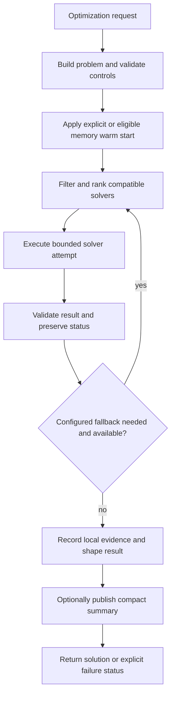

# Optimization Agent System

## Overview

The Optimization subsystem builds canonical mathematical problems, classifies their requirements, selects compatible available solvers, executes bounded single- or multiobjective workflows, and preserves feasibility, optimality and termination evidence. [OptimizationAgent](../optimization_agent.py) supplies the SLAI runtime boundary, local evidence ownership, metrics and compact SharedMemory publication.

The facade inherits `BaseAgent`, has constructor `OptimizationAgent(shared_memory, agent_factory, config=None, *, checkpoint_manager=None)`, and is registered as `optimization`. `optimize(request)` runs one request outside the Base execution/retry envelope; `perform_task(task_data)` additionally supports a sequential task batch.

## Module Structure

| Module | Components | Responsibility |
| --- | --- | --- |
| [optimization_types.py](optimization_types.py) | `VariableDomain`, `Variable`, `Objective`, `Constraint`, `OptimizationProblem`, `Solution`, `OptimizationResult` | Solver-neutral problem and result contracts |
| [modules/problem_definition.py](modules/problem_definition.py) | `ProblemDefinition` | Mapping/template construction, assignment validation, evaluation, sampling and descriptions |
| [optimization_math.py](optimization_math.py) | Classification/evaluation/constraint helpers | Domain/objective evaluation, violations, matrix conversion, initial points and bounds |
| [optimization_solver.py](optimization_solver.py) | `OptimizationSolver` | Selection, attempts, fallback, result validation and evidence recording |
| [optimization_registry.py](optimization_registry.py) | `OptimizationRegistries` | Composes capability, solver and scalarization registries |
| [registries/capability_registry.py](registries/capability_registry.py) | `CapabilityRegistry` | Hard mathematical compatibility and capability coverage |
| [registries/solver_registry.py](registries/solver_registry.py) | `SolverRegistry` | Availability, priority and historical-evidence ranking |
| [registries/scalarization_registry.py](registries/scalarization_registry.py) | `ScalarizationRegistry` | Named multiobjective reformulations |
| [solvers/base_solver.py](solvers/base_solver.py) | `BaseSolver` | Backend/compatibility checks, timing and feasibility/result validation |
| [solvers/](solvers/) | Five concrete solver classes | Linear, quadratic, nonlinear, finite-domain and derivative-free execution |
| [modules/multiobjective.py](modules/multiobjective.py) | `Multiobjective` | Weighted, epsilon-constraint and lexicographic workflows |
| [modules/pareto_efficiency.py](modules/pareto_efficiency.py) | `ParetoEfficiency` | Dominance, fronts, crowding, metrics, archive updates and candidate selection |
| [optimization_memory.py](optimization_memory.py) | `OptimizationMemory`, `OptimizationRunRecord`, `SolverStatistics` | Local evidence, historical preference, best-known solutions and warm starts |
| [utils/temp_loader.py](utils/temp_loader.py), [templates/](templates/) | Template access and assets | Declarative problem templates and schemas |

## Problem Contracts

`ProblemDefinition.build(spec)` accepts a mapping and returns `OptimizationProblem`. Variables and objectives can be named mappings or supported typed/name-bearing sequences; constraints are a sequence. The builder also supports templates through `from_template()`.

| Element | Representation and semantics |
| --- | --- |
| Variables | Named `Variable` objects with `VariableDomain`, optional initial values and shape/metadata |
| Domains | Real, integer, binary, finite, semi-continuous, semi-integer and custom representations; backend support varies |
| Objectives | Named sense, linear/quadratic coefficients, constant, callable or restricted expression; optional derivatives, weights and priority |
| Constraints | Linear/quadratic/callable relations with sense, right-hand side and tolerance |
| Classification | Derived `ProblemClass`/features plus explicit declarations such as known convexity/smoothness |
| Assignment | Mapping from variable names to values, validated against domains and constraints |

Objective callbacks consume a decision mapping and return a numeric objective value. Algebraic coefficient keys reference variable names; quadratic mappings identify pairs. Restricted expressions are parsed through `compile_expression()` rather than unrestricted Python execution. An objective direction alone is insufficient: provide an actual function/expression or coefficients.

`ProblemDefinition` evaluates, validates and samples problems; solving belongs to `OptimizationSolver`. Available domain types do not imply every solver supports them. For example, the black-box solver requires finite bounds and scalar variables, and exact finite-domain search must enumerate bounded domains. Constraints and feasibility are evaluated with explicit tolerances; a returned candidate is not automatically feasible or optimal.

## Solver Strategies

| Registry identifier / class | Implemented approach | Important limits |
| --- | --- | --- |
| `scipy_highs_linear` / `LinearSolver` | SciPy HiGHS linear programming and supported mixed-integer linear problems | Linear algebraic structure and backend capabilities required |
| `scipy_quadratic` / `QuadraticSolver` | SciPy constrained quadratic optimization, default `trust-constr` | Compatibility/convexity checks matter; distinguish backend convergence from global claims |
| `scipy_nonlinear` / `NonLinearSolver` | SciPy nonlinear constrained optimization, default `SLSQP` | Continuous/local numerical behavior; no general global-optimum guarantee |
| `finite_domain_exact` / `CombinatorialSolver` | Finite-domain search with propagation, variable ordering and objective bounds | Node/evaluation/domain limits can stop exhaustive search |
| `black_box_derivative_free` / `BlackBoxSolver` | Differential evolution or native mesh-refining pattern search | Finite bounds, budget/penalty handling, no fabricated global certificate |

Selection first respects compatibility and availability, then preference/history. Lower configured numeric priority is preferred before empirical evidence. An explicitly requested solver still has to support the problem. NumPy/SciPy are imported by solver modules, including the black-box module even when selecting pattern search; native algorithms do not imply that the aggregate package imports without SciPy.

`OptimizationSolver.solve_single_detailed(problem, ...)` returns the detailed result; `solve_single()` exposes the single-solution path. `solve_multiobjective()` supports weighted-front, epsilon-constraint and lexicographic workflows. Weighted and epsilon grids are finite approximations, not guarantees of the full Pareto set. Pareto metrics and archive selection are separate from a solver's optimality evidence.

## Agent Request and Result Contracts

| Request field | Behavior |
| --- | --- |
| `problem` | Required `OptimizationProblem` or builder mapping |
| `solver` | Optional nonempty solver identifier |
| `options` | Solver options mapping |
| `allow_fallback` | Optional boolean; otherwise subsystem policy applies |
| `warm_start` | Variable-name/value mapping applied to canonical initial values; unknown names fail |
| `method` / `workflow` | Multiobjective method; defaults to `weighted` for multiobjective problems |
| `weight_vectors`, `epsilon_grid`, `primary` | Method-specific multiobjective controls; rejected for single-objective problems |
| `time_limit_seconds`, `max_evaluations`, `max_nodes`, `node_limit` | Positive execution budgets merged into options; conflicting duplicate values fail |
| `request_id`, `metadata`, `context` | Request identity and structured caller context |
| `publish` | Optional boolean overriding publication default |
| `tasks` | Batch wrapper; outer batch mapping must contain only this field |

Unknown top-level fields are rejected under strict validation. Batch size must be nonzero and within `max_batch_size`; execution is sequential and exceptions interrupt the batch without rolling back earlier solves.

The facade returns run/request identity, problem fingerprint, success/status, solver attempt/evidence information, duration and structured solution/Pareto data where available. Solution data retains solver status, termination reason, feasibility, optimality, objectives, optional decision variables, violations, bounds/gaps, iterations/evaluations and warnings. Shared publication adds a reference when successful.

`success` or `status: "success"` does not mean a global optimum was proven: feasible solutions can be successful. Inspect `solver_status`, `termination_reason`, `feasibility` and `optimality`. Batch status is `success` only when every result has truthy success; otherwise it is `partial_success`.

## Processing Workflow



The detailed attempt list records availability, compatibility, preference, solver status, termination and errors where present. Multiobjective workflows reformulate/run constituent problems and filter resulting candidates. Result selection must preserve each underlying solver's evidence and feasibility semantics.

## Stopping, Constraints and Reproducibility

Stopping is solver-specific: backend convergence, infeasibility/unboundedness reports, iteration/evaluation/node limits, deadlines, numerical failures and interruption remain distinct. Finite-domain exactness depends on completing the relevant search; a node-limited incumbent is not an exhaustive optimality result.

Black-box constraint penalties guide candidate search, while explicit feasibility checks determine reported feasibility. Differential evolution uses the configured seed; pattern search follows its mesh policy. Reproducibility also depends on callback determinism, backend versions, initial values and memory-based ranking/warm starts. Record those inputs rather than attributing all differences to random seeds.

No automatic connection to Simulation, Learning or STEM is installed by the Optimization facade. An application may supply a mathematical callback backed by those components, but must define cost, determinism, domain validity and side effects itself. The subsystem is separate from SLAI's general tuning infrastructure.

## Configuration

Facade settings live in `optimization_agent` in [agents_config.yaml](../base/configs/agents_config.yaml); mathematical policy lives in [optimization_config.yaml](configs/optimization_config.yaml).

| Facade setting | Default | Contract |
| --- | --- | --- |
| `enabled`, `strict_validation`, `metrics_enabled` | `true` | Actual booleans |
| `shared_memory_enabled`, `publish_shared_results` | `true` | Shared-summary permission/default |
| `shared_memory_ttl_seconds` | `86400` | Null or finite positive numeric value; booleans rejected |
| `shared_result_key_prefix`, `shared_latest_key`, `shared_event_topic` | `optimization_agent.result`, `optimization_agent.latest`, `optimization.events` | Nonempty strings |
| `include_decision_variables_in_shared_memory` | `true` | Compact publication content |
| `max_shared_pareto_points`, `max_shared_warnings` | `32`, `16` | Positive integers |
| `max_batch_size`, `local_reference_limit` | `16`, `32` | Positive integers |

| Subsystem section | Selected checked-in defaults |
| --- | --- |
| `base_solver` | Feasibility/optimality tolerances `1e-8`; result validation and strict success-feasibility checks enabled |
| `problem_definition` | Feasibility tolerance `1e-8`; expression length 1000; sample-attempt factor 50 |
| `optimization_solver` | Fallback and memory warm starts enabled; fallback statuses include numerical failure, error, unavailable and unsupported outcomes |
| `optimization_registries` | Priorities 10/20/30/40/50 for the five solver identifiers; evidence weight 25 |
| `optimization_memory` | 5000 records; statistics window 250; autosave false; no persistence path |
| `linear_solver` | HiGHS, presolve true, MIP relative gap `1e-6` |
| `quadratic_solver` | `trust-constr`, 1000 iterations, PSD tolerance `1e-10` |
| `non_linear_solver` | `SLSQP`, 1000 iterations, no configured evaluation maximum |
| `combinatorial_solver` | One million nodes/evaluations; domain cardinality 100000; propagation and objective bounds enabled |
| `black_box_solver` | Differential evolution; 5000 evaluations; seed 0; population size setting 12; tolerance `1e-7`; polishing false |
| `multiobjective` | 11 weight samples, 9 epsilon samples, archive limit 512, crowding truncation, seed 0 |

Use the exact section name `non_linear_solver`. A facade `config` override does not directly replace subsystem solver settings; per-run `options` are forwarded where the selected solver supports them.

## Memory, Integration and Cleanup

`local_memory` is an `OptimizationMemory` instance shared with `OptimizationSolver`. It is the local evidence store, distinct from BaseAgent's SharedMemory. History supports solver statistics, best-known solutions and warm starts. Disk persistence requires explicit configuration/use; checked-in defaults disable autosave and provide no path.

Shared publication contains bounded summaries and references, not a second complete evidence store. Result, latest-pointer and event publication failures are recorded as degraded persistence and warnings while preserving a valid mathematical result. Local evidence persistence failures similarly remain visible without inventing a solver failure.

Checkpoint hooks expose agent-owned state through BaseAgent's checkpoint contract. The facade's `shutdown()` transitions runtime lifecycle to stopped without clearing local evidence or SharedMemory. The factory owns managed instances; it does not own externally supplied objective callbacks or their resources. No trained-model artifact is loaded by the Optimization facade.

## Minimal Usage

A low-level bounded linear problem:

```python
from src.agents.optimization.modules.problem_definition import ProblemDefinition
from src.agents.optimization.optimization_solver import OptimizationSolver

problem = ProblemDefinition().build({
    "name": "bounded_linear",
    "variables": {"x": {"kind": "real", "lower": 0.0, "upper": 10.0}},
    "objectives": {"cost": {"sense": "minimize", "linear": {"x": 1.0}}},
})
result = OptimizationSolver().solve_single_detailed(problem, solver="scipy_highs_linear")
assert result.solution is not None
assert abs(result.solution.primal_solution["x"]) < 1e-8
```

The equivalent managed facade request requires the full SLAI runtime:

```python
from src.agents.agent_factory import AgentFactory

factory = AgentFactory()
try:
    agent = factory.create("optimization", config={"publish_shared_results": False})
    result = agent.optimize({
        "problem": {
            "name": "bounded_linear",
            "variables": {"x": {"kind": "real", "lower": 0.0, "upper": 10.0}},
            "objectives": {"cost": {"sense": "minimize", "linear": {"x": 1.0}}},
        },
        "solver": "scipy_highs_linear",
    })
    print(result["status"], result["solution"])
finally:
    factory.shutdown()
```

## Error Handling and Limitations

Malformed problems/requests raise Optimization validation/configuration errors. Backend incompatibility, unavailability, execution failure and invalid results have distinct typed errors. The facade wraps selected unexpected numerical boundary exceptions in `SolverExecutionError`. Solver-reported infeasibility, unboundedness, timeout and limits remain explicit result outcomes where the solver returns them.

Backend fallback is handled by `OptimizationSolver`. `OptimizationAgent.alternative_execute()` deliberately returns a failed result instead of synthesizing a textual or echoed mathematical solution. A solver declaration, successful import or nonempty Pareto front is not a convergence/global-optimality certificate.

Historical memory influences selection and initial values but is not a trained ranking model. Full multiobjective coverage, general mixed-integer nonlinear optimization, arbitrary tensor variables and global guarantees must not be inferred from the general problem representation.

## Testing and Verification

There is no dedicated Optimization test suite under `tests/` in this checkout. The low-level example checks one installed HiGHS path; it does not establish availability or correctness of every solver. Use `OptimizationRegistries.summary(problem)` and `registry_summary()` to inspect compatibility/coverage without claiming that uncovered problem classes are supported.

A non-importing syntax check from the repository root is:

```bash
python -c "import ast,pathlib; [ast.parse(p.read_text(encoding='utf-8')) for p in pathlib.Path('src/agents/optimization').rglob('*.py')]; ast.parse(pathlib.Path('src/agents/optimization_agent.py').read_text(encoding='utf-8'))"
```

Runtime changes should additionally verify infeasible/unbounded inputs, unsupported backends, evaluation limits, explicit warm starts, multiobjective status preservation and evidence/publication failures. Run embedded demonstrations only after reviewing their solver and persistence effects.

## Related Documentation

- [Agent architecture](../README.md), [Factory](../factory/README.md), [Base runtime](../base/README.md)
- [STEM](../stem/README.md), [Spatial](../spatial/README.md), [Simulation](../simulation/README.md)
- [Learning](../learning/README.md), [Planning](../planning/README.md)
