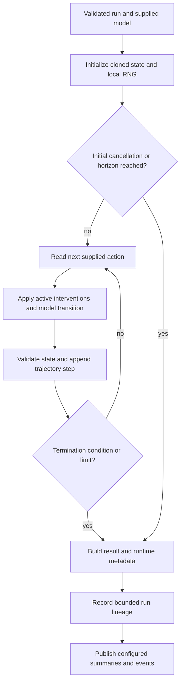

# Simulation Agent System

## Overview

The Simulation subsystem executes externally supplied actions through an explicitly supplied state-transition model. It owns bounded execution, simulated time, trajectories, seeded sampling, scenario evaluation and descriptive analysis. It does not choose actions, optimize objectives, discover causal structure, formally verify a system or apply safety gates.

[SimulationAgent](../simulation_agent.py) integrates these components with BaseAgent, SharedMemory, run lineage and checkpoint hooks. Its constructor is `SimulationAgent(shared_memory, agent_factory, config=None, *, vocabulary=SimulationVocab, checkpoint_manager=None)`. The factory identifier is `simulation`.

## Module Structure

| Module | Components | Responsibility |
| --- | --- | --- |
| [simulation_types.py](simulation_types.py) | `SimulationRequest`, `SimulationResult`, `Trajectory`, `TrajectoryStep`, `TransitionOutcome`, scenario/intervention/result types | Typed run inputs, state evolution, termination and evidence |
| [simulation_models.py](simulation_models.py) | `SimulationModel`, `CallableSimulationModel`, `SimulationModelRegistry`, `ModelDescriptor` | Model protocol, callback adapter and explicit registration |
| [engine/base_engine.py](engine/base_engine.py) | `BaseEngine` | Initialize state/RNG, execute supplied actions, enforce limits and record trajectory |
| [engine/rollout_engine.py](engine/rollout_engine.py) | `RolloutEngine`, `CounterfactualRollout` | Single/multiple rollouts, counterfactuals, perturbations and replay |
| [engine/scenario_engine.py](engine/scenario_engine.py) | `ScenarioEngine` | Scenario execution, bounded branching and parameter designs |
| [modules/state_transition.py](modules/state_transition.py) | `StateTransition` | Clone/validate state, invoke model transition and normalize outcomes |
| [modules/monte_carlo.py](modules/monte_carlo.py) | `MonteCarlo` | Seeded repeated sampling, concurrency and error policy; Latin hypercube design |
| [models/stochastic_model.py](models/stochastic_model.py) | `StochasticModel`, distributions/events | Explicit stochastic sampling and transition support |
| [models/world_model.py](models/world_model.py) | `WorldModel` | Adapter for caller-supplied world dynamics and external-state synchronization |
| [simulation_analysis.py](simulation_analysis.py) | `SimulationAnalysis` | Distribution summaries, convergence diagnostics, branch frequencies, divergence, OAT/Morris/Sobol estimates |
| [simulation_memory.py](simulation_memory.py) | `SimulationMemory`, `SimulationMemoryRecord` | Bounded run metadata, lookup and lineage |
| [utils/simulation_helpers.py](utils/simulation_helpers.py) | RNG, state and serialization helpers | Seed normalization/spawning, state cloning, finite-state validation and fingerprints |

## Model and State Contracts

`SimulationModel` declares `model_id`, `version`, `stochastic`, and `initialize()`, `transition()`, `observe()`, `snapshot()` methods. The transition contract receives keyword arguments:

```text
state, action, interventions, parameters, rng, step, simulation_time, dt
```

It returns a new state or `TransitionOutcome`, which can also mark termination and provide metadata. `CallableSimulationModel(transition_fn, *, model_id="callable-model", version="1", stochastic=False, initialize_fn=None, observe_fn=None, snapshot_fn=None, thread_safe=False, metadata=None)` adapts narrower callables by passing supported arguments.

Model registration is explicit: `register_model(model, replace=None)` returns a descriptor, `registered_models()` lists descriptors, and `unregister_model(model_id)` removes a model without closing it. A run can instead supply `model` directly. The facade does not download, train or automatically load a learned world-model artifact. Learned or external dynamics carry their own dependencies, state and validity assumptions.

`SimulationRequest` contains `initial_state`, an explicit action sequence, parameters, interventions, run/scenario identifiers, seed, deterministic/stochastic mode, step/time horizons, time step, timeout, termination/cancellation callbacks and metadata. State validation and cloning support the subsystem's permitted data representations; arbitrary objects are not implicitly safe to clone, validate or serialize. Time and state units are defined by the supplied model, not by the engine.

## Agent Operations

`simulate(request)` accepts `SimulationAgentRequest` or a mapping and returns a typed outcome. `perform_task(task_data)` normalizes the request and converts the outcome to a dictionary. `predict()` and `act()` delegate mapping requests through that interface.

| Operation | Required inputs / behavior | Outcome |
| --- | --- | --- |
| `rollout` | Simulation request plus `model` or registered `model_id` | `SimulationResult` |
| `transition` | Same, with exactly one externally supplied action | `SimulationResult` |
| `monte_carlo` | Run request/model; options such as sample count, seed, concurrency and continue-on-error | `MonteCarloResult` |
| `scenario` | Run request/model and either one `scenario` or a `scenarios` sequence | Single result or `ScenarioBatchResult` |
| `counterfactual` | Run request/model and external interventions; optional baseline execution | `CounterfactualRollout` |
| `perturbation` | Run request/model and nonempty `parameter_overrides` | `SimulationResult` |
| `sensitivity` | Method-specific numerical data in `options` | `SensitivityEstimate` |
| `analysis` | Supported analysis method and data in `options` | Analysis mapping/result |
| `replay` | Original typed `source_result` plus model/model ID | `SimulationResult` |

A mapping can use nested `simulation` (or `request`), or compact top-level `initial_state` and `actions`. Scenario/intervention mappings are normalized into their typed objects. For compact counterfactual requests, top-level interventions describe the alternate run; baseline interventions must be explicit inside nested `simulation`.

Analysis selects `options.kind` from `distribution`, `convergence`, `trajectory_divergence`, `branch_frequencies` and `monte_carlo`; each requires its corresponding numerical values, trajectories or typed batch/extractors. Sensitivity selects `options.method` and supports `oat`/`one_at_a_time`, `morris` and `sobol`, consuming supplied experimental outputs rather than automatically designing or optimizing a scientific model. Replay requires the original `SimulationResult`; a bounded history record is not a full typed-result database.

## Execution Lifecycle



`BaseEngine.run(request, model, *, seed=None, rng=None, branch_metadata=None, metadata=None)` records the initial state at step zero. Each transition uses the current supplied action and active interventions, then increments simulated time by `time_step`. Execution stops on action exhaustion, step/time horizon, model terminal flag, user termination, cancellation or configured engine depth. Timeout checks raise a simulation timeout error; they do not manufacture a completed trajectory.

A result preserves trajectory, model/run identity, concrete seed, RNG state information, termination reason, runtime metadata and warnings. Engine-limit termination is distinct from completing the requested horizon. Descriptive summaries do not constitute physical validation or proof of model fidelity.

## Randomness and Repeatability

The subsystem uses local NumPy generators and explicit seed helpers. Monte Carlo derives child seeds and preserves sample identity. Injecting an RNG into `BaseEngine.run()` requires its originating seed. A model marked stochastic cannot be used with a deterministic request mode.

Counterfactual baseline/alternate execution uses a common seed. Multiple-rollout concurrency is conditional on model thread-safety; a model not declaring safe parallel use is not assumed independent. Reproduction still depends on deterministic model code, stable configuration, compatible numerical libraries and restoration of any external model state. A seed alone does not control external I/O or hidden mutable callback state.

Replay is a rerun through supplied dynamics, not serialized executable-model restoration. Retain original typed results and model/version information when reproducibility is required.

## Configuration

Facade settings are in `simulation_agent` in [agents_config.yaml](../base/configs/agents_config.yaml). The subsystem independently loads [simulation_config.yaml](configs/simulation_config.yaml).

| Facade setting | Default | Purpose |
| --- | --- | --- |
| `enabled`, `default_operation` | `true`, `rollout` | Enable execution and choose default task operation |
| `publish_lifecycle_events`, `publish_results`, `publish_errors` | `true` | Shared publication channels |
| `shared_memory_ttl_seconds` | `86400` | Publication retention |
| `max_recent_runs` | `256` | Bounded local run history |
| `store_request_payloads` | `true` | Retain request metadata/payload representation |
| `retain_full_results_in_sim_memory` | `false` | Avoid retaining full result payloads by default |
| `include_trajectory_in_shared_memory` | `false` | Keep full trajectories out of shared publication by default |
| `max_shared_trajectory_steps`, `max_shared_list_items`, `max_shared_string_length` | `64`, `128`, `4096` | Shared-payload bounds |
| `event_channel` | `simulation.events` | Lifecycle channel |
| `result_key_prefix`, `summary_key_prefix`, `error_key_prefix`, `latest_result_key` | `simulation_agent.result`, `.summary`, `.error`, `.latest` with the same prefix | Shared result/summary/error/latest keys |

Boolean/integer helpers coerce facade options into configured bounds. Publication-enabled construction requires callable SharedMemory `set` and `publish`. The default operation must be a supported enumeration value, and publication names must be nonempty.

| Subsystem section | Selected defaults |
| --- | --- |
| `base_engine` | Maximum rollout depth 10000; maximum state size 1000000; no default timeout |
| `state_transition` | Clone input/output state; maximum state size 1000000 |
| `monte_carlo` and nested sampling settings | 100 samples; maximum 10000; concurrency 1; `continue_on_error: false`; no default timeout |
| `scenario_engine` | Maximum 256 branches and depth 8 |
| `simulation_model` | Replacement disabled by default |
| `simulation_analysis` | Confidence level 0.95; convergence tolerance 0.01, minimum 30 samples, window 20 |
| `simulation_memory` | 256 records; request payloads on, full result payloads off |

Engine facades read nested configuration sections; changing a standalone section must not be assumed to override every nested engine setting. Request-level limits/options apply where explicitly passed through by the selected operation.

## Integration and Ownership

Use `AgentFactory.create("simulation", shared_memory=..., config=...)`, then inject/register a model or provide one with the request. The factory handles agent construction; `SimulationModelRegistry` handles simulation models. They are different registries.

`SimulationMemory` stores bounded evidence and lineage. `recent_runs(limit=None)` and `run_lineage(run_id)` expose that history. SharedMemory receives configured summaries, events and references. Checkpoint support exports agent-owned state through BaseAgent; it does not recreate arbitrary callbacks, external services or learned-model objects. Unregistering a model does not close caller-owned resources.

STEM equations, Spatial representations or Optimization objectives can be used by application-supplied models/callbacks, but the Simulation facade does not automatically construct a coupled solver pipeline. It executes supplied actions and reports outcomes without ranking plans.

## Minimal Usage

A low-level model and deterministic rollout, run from the repository root with existing dependencies:

```python
from src.agents.simulation import CallableSimulationModel, SimulationRequest, RolloutEngine

model = CallableSimulationModel(
    lambda state, action: state + action,
    model_id="accumulator",
)
request = SimulationRequest(initial_state=0.0, actions=(1.0, 2.0), seed=42)
result = RolloutEngine().rollout(request, model)
assert result.terminal_state == 3.0
```

The same model can be supplied through the managed facade:

```python
from src.agents.agent_factory import AgentFactory
from src.agents.simulation import CallableSimulationModel

factory = AgentFactory()
try:
    agent = factory.create("simulation")
    agent.register_model(CallableSimulationModel(
        lambda state, action: state + action,
        model_id="accumulator",
    ))
    result = agent.simulate({
        "operation": "rollout",
        "model_id": "accumulator",
        "simulation": {"initial_state": 0.0, "actions": [1.0, 2.0], "seed": 42},
    })
    assert result.terminal_state == 3.0
finally:
    factory.shutdown()
```

## Error Handling and Limitations

Request/configuration errors use Base or Simulation validation errors. Model initialization, transition callbacks, invalid probabilities, state size/nonfinite state, timeout, branch limits and reproducibility failures have specific `SimulationError` subclasses. The facade records and republishes Simulation failures where configured, then re-raises them; unexpected orchestration exceptions become `BaseRuntimeError` with the original cause.

Monte Carlo continuation after individual failures is an explicit option. It is not automatic recovery of a bad transition. Cancellation and bounded termination must be interpreted from result semantics; timeout exceptions are separate. Numerical execution and descriptive uncertainty estimates do not establish physical accuracy, scientific validation, safety or production readiness.

## Testing and Verification

There is no dedicated Simulation test suite under `tests/` in this checkout. The examples exercise supplied-model propagation and facade registration; embedded module demonstrations should be inspected for publication and persistence effects before execution. NumPy, configuration/logging dependencies and transitive shared-runtime imports are required; external models may require additional existing packages.

A non-importing syntax check from the repository root is:

```bash
python -c "import ast,pathlib; [ast.parse(p.read_text(encoding='utf-8')) for p in pathlib.Path('src/agents/simulation').rglob('*.py')]; ast.parse(pathlib.Path('src/agents/simulation_agent.py').read_text(encoding='utf-8'))"
```

For runtime changes, verify seed repeatability, initial/step termination, cancellation, invalid state rejection, model-registration conflicts, lineage retention and replay requirements separately. Syntax success is not runtime or scientific validation.

## Related Documentation

- [Agent architecture](../README.md), [Factory](../factory/README.md), [Base runtime](../base/README.md)
- [STEM](../stem/README.md), [Spatial](../spatial/README.md), [Optimization](../optimization/README.md)
- [Learning](../learning/README.md), [Planning](../planning/README.md)
