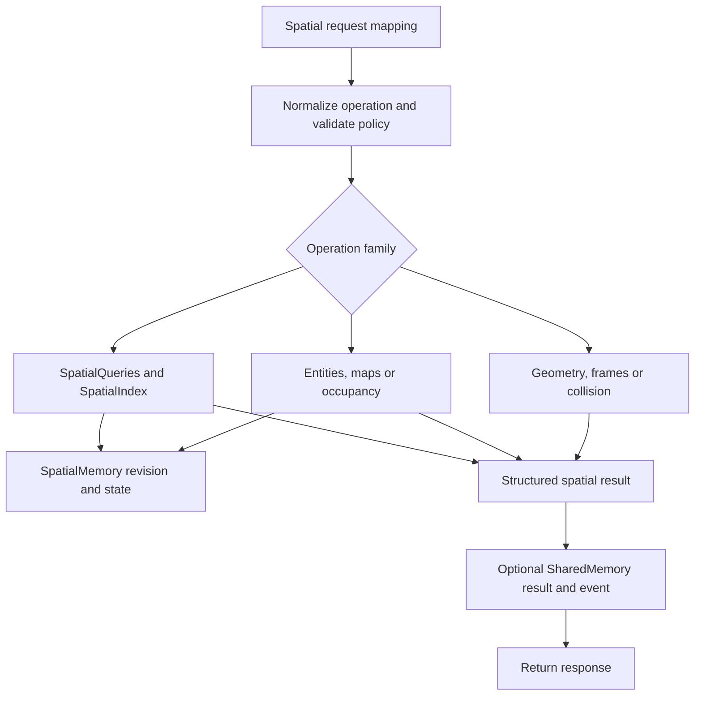

# Spatial Agent System

## Overview

The Spatial subsystem represents interpreted spatial state and computes geometry, coordinate transforms, spatial relations, neighborhood queries, collision/visibility information, occupancy and point-cloud alignment. [SpatialAgent](../spatial_agent.py) exposes these operations through a validated task facade. It does not interpret raw sensor modalities, choose routes, plan navigation or select avoidance actions.

The facade inherits `BaseAgent`, has constructor `SpatialAgent(shared_memory, agent_factory, config=None, *, checkpoint_manager=None)`, and is registered as `spatial`. `predict()` and `act()` are compatibility routes to structured spatial computation, not learned policies.

## Module Structure

| Module | Components | Responsibility |
| --- | --- | --- |
| [spatial_types.py](spatial_types.py) | `SpatialEntity`, `SpatialBounds`, `SpatialReference`, `SpatialQueryResult`, relation/geometry enums | Spatial input, state and result contracts |
| [spatial_memory.py](spatial_memory.py) | `SpatialMemory` | Authoritative entities, revisions, relations, transforms, artifacts and query cache |
| [spatial_index.py](spatial_index.py) | `SpatialIndex`, `KDTree` | Exact point-neighbor queries and vectorized AABB bounds filtering |
| [spatial_queries.py](spatial_queries.py) | `SpatialQueries` | Query composition over a coherent index/memory/relation view |
| [spatial_relations.py](spatial_relations.py) | `SpatialRelations` | Geometric topology and qualitative point relationships |
| [spatial_compute.py](spatial_compute.py) | `SpatialCompute` | Distance, bounds, collision, visibility and coordinate facade |
| [modules/transform.py](modules/transform.py) | `RigidTransform`, SO(3)/SE(3) functions | Rigid motion, quaternion/matrix conversion and composition |
| [modules/coordinate_frames.py](modules/coordinate_frames.py) | `FrameGraph`, `CRSRegistry`, `CoordinateFrames` | Frame hierarchy, transform resolution and registered CRS conversion |
| [modules/calculations.py](modules/calculations.py) | `Calculations` | Vector distances/products, projections and geometric calculations |
| [modules/mapping.py](modules/mapping.py) | `Mapping`, `MapRecord`, `AlignmentResult` | Map records, best-fit rigid alignment, ICP and point-cloud merging |
| [world/geometry.py](world/geometry.py) | `AABB`, `OBB`, `Sphere`, `Ray`, `Segment`, `Plane`, `Triangle`, `Polygon`, `PointCloud`, `Mesh` | Validated primitive representations and intersection helpers |
| [world/collision.py](world/collision.py) | `CollisionEngine`, `CollisionResult`, `MeshBVH` | Supported primitive tests and conservative mesh broad phase |
| [world/topology.py](world/topology.py), [world/visibility.py](world/visibility.py) | `Topology`, `Frustum`, visibility helpers | Supported topological predicates and visibility/occlusion calculations |
| [world/occupancy.py](world/occupancy.py) | `OccupancyGrid2D`, `VoxelGrid`, `OctreeOccupancy`, `TSDFVolume`, `ESDFVolume` | Grid/voxel probability and distance-field storage/update interfaces |

## Data and Coordinate Contracts

Entities carry identity, position/frame and optional geometric information; handlers accept typed objects or supported mappings and normalize them before computation. Array inputs must have the required shape and finite numeric values. Geometry determines dimensionality: some point/bounds operations support 2D or 3D, while rigid transforms and cross-frame distance require 3D coordinates.

`RigidTransform` maps source to target using `p_target = R @ p_source + t`. Rotations are right-handed, orthonormal matrices with determinant +1. Quaternions use `(w, x, y, z)`. Roll/pitch/yaw conversion is `Rz(yaw) @ Ry(pitch) @ Rx(roll)`. `a_to_b.then(b_to_c)` produces `a_to_c`; vectors rotate without translation, while points include translation.

`SpatialCompute.transform_entity()` changes the entity position but does not transform attached non-point geometry. Keep geometry operands in a common frame or explicitly transform the geometry before relation/collision work.

Frame transforms do not infer physical units. Coordinates, translation vectors, radii and distances must use consistent units. `CRSRegistry` provides registered conversions, including geodetic/ECEF functions; this is a bounded coordinate facility, not an arbitrary GIS/reprojection stack.

Default helper tolerances are absolute `1e-9`, relative `1e-9`, and angular `1e-8`. NumPy floating-point calculations and geometry-specific tolerances determine behavior near boundaries; there is no exact-arithmetic guarantee.

## Public Operations

`perform_task(task_data)` takes a mapping with `operation` (or `op`), operation-specific fields and an optional `request_id`. `capabilities()` returns allowed operations and explicit scope flags.

| Operation group | Canonical names | Input/output purpose |
| --- | --- | --- |
| Inspection | `capabilities`, `status` | Operation policy and current state |
| Entities | `upsert_entity`, `get_entity`, `remove_entity` | Normalize/register, retrieve or remove identified entities |
| Geometry | `distance`, `bounds`, `collision`, `visibility` | Numeric distance, bounding representation, collision state or visible results |
| Frames | `register_frame`, `set_frame_parent`, `set_frame_transform`, `remove_frame`, `resolve_transform` | Maintain frame relationships and resolve transforms |
| Transforms | `transform_point`, `transform_vector`, `transform_pose`, `transform_crs` | Convert supplied coordinates using explicit frame/CRS information |
| Relations/index | `relation`, `nearest`, `k_nearest`, `within_radius`, `within_bounds`, `relation_query` | Predicate and neighborhood results |
| Maps | `register_map`, `get_map`, `remove_map`, `map_summary`, `align_point_clouds` | Stored map metadata and alignment results |
| Occupancy | `occupancy_lookup`, `occupancy_update` | Supported map occupancy/distance-field access |

Aliases include `register_entity`/`update_entity`, `transform`, `nearest_neighbor`, `knn`, `visible_from`, and `align`. Configuration `allowed_operations` is checked against canonical operation names.

For `distance`, `source` and `target` are required; operands can resolve positions/entities. `source_frame` and `target_frame` provide optional frame hints. Matching dimensions are required; different explicit frames trigger transformation of the target into the source frame. Results include `distance`, `metric`, `frame_id`, `source_entity` and `target_entity`.

Successful requests return `status: "ok"`, `agent`, `request_id`, canonical `operation`, and serialized `result`. Disabled operation returns a `disabled` envelope with `result: None`. Query and result limits can bound returned data; do not assume a serialized response contains the entire state.

## Processing Workflow



The index rebuilds lazily when the authoritative entity revision changes. Nearest queries use a balanced k-d tree; bounds queries use bounding-volume filters. The default subsystem memory is process-local and shared through `get_default_spatial_memory()`. Separately constructed facade/index objects must not be assumed to have isolated worlds. Low-level components accepting a `SpatialMemory` argument allow explicit ownership where supported.

## Configuration

Facade settings are resolved from `spatial_agent` through the main configuration loader and constructor overrides. This checkout does not define a `spatial_agent` section in the main YAML, so in-code defaults apply unless overridden. [spatial_config.yaml](configs/spatial_config.yaml) contains empty section mappings for index, memory, queries, relations, frames, mapping, collision, geometry, occupancy and topology; it does not supply a complete set of active tuning values.

| Facade setting | Default | Constraint / behavior |
| --- | --- | --- |
| `enabled`, `publish_shared_memory` | `true` | Execution and publication switches |
| `fail_on_shared_memory_error` | `false` | Publication failure policy |
| `shared_memory_ttl_seconds` | `3600` | Coerced into 0–31536000 |
| `max_query_results` | `128` | Coerced into 1–100000 |
| `max_result_items` | `256` | Coerced into 8–100000 |
| `max_obstacles` | `512` | Coerced into 0–100000 |
| `max_points_per_request` | `100000` | Coerced into 3–5000000 |
| `result_key_prefix`, `event_channel` | `spatial_agent.result`, `spatial_agent.events` | Nonempty names |
| `allowed_operations` | All handlers | Sequence of supported canonical operation names |

The facade applies shared boolean/integer coercion helpers. Unsupported operation names or empty publication identifiers are configuration errors. Numerical transform and geometry validation remains within the subsystem.

## Integration and Persistence

Use `AgentFactory.create("spatial", shared_memory=..., config=...)`. The facade composes `SpatialQueries`, `SpatialCompute` and `Mapping`; it does not automatically invoke Perception, Planning, Simulation or STEM. Those components can exchange interpreted data/results through explicit calls or SharedMemory. No trained-model loader is installed by this facade.

Shared publication is distinct from authoritative `SpatialMemory`. Checkpoint support uses agent-owned state export/restore hooks and BaseAgent's external checkpoint manager. Frame graphs, entity state, supported map representations and metadata require their explicit serialization paths; arbitrary live objects should not be assumed checkpoint-safe. Factory instance release is not a reset of the process-global spatial world.

## Minimal Usage

A computation-only subsystem example:

```python
from src.agents.spatial.spatial_compute import SpatialCompute

compute = SpatialCompute()
assert compute.distance([0.0, 0.0, 0.0], [3.0, 4.0, 0.0]) == 5.0
```

The equivalent managed facade request, requiring the full BaseAgent runtime:

```python
from src.agents.agent_factory import AgentFactory

factory = AgentFactory()
try:
    agent = factory.create("spatial", config={"publish_shared_memory": False})
    response = agent.perform_task({
        "operation": "distance",
        "source": [0.0, 0.0, 0.0],
        "target": [3.0, 4.0, 0.0],
    })
    assert response["result"]["distance"] == 5.0
finally:
    factory.shutdown()
```

## Error Handling and Limitations

Malformed requests raise Base validation errors; unsupported/disabled-by-policy operations raise `SpatialQueryError`. Geometry, frames, mapping, occupancy, topology and index failures use the corresponding `SpatialError` subclasses. Handler failures are recorded, a failure event is attempted, and the original exception is re-raised. Publication errors follow the configured failure policy.

Collision semantics depend on the geometry pair. AABB, sphere and OBB pairs have dedicated tests; mesh/mesh uses candidate triangle bounds and marks `broad_phase_only=True`. A positive broad-phase result is not an exact mesh-intersection proof. For separated OBBs, the collision code reports an unavailable distance as NaN rather than an exact separation metric. Topological operations raise on unsupported pairs rather than silently substituting bounds semantics.

ICP is iterative point-cloud registration, not full SLAM or global alignment certification. Occupancy/TSDF/ESDF classes provide storage and update operations; their presence does not imply a sensor-fusion pipeline or a complete distance-field reconstruction algorithm. Visibility and collision outputs do not certify safe motion.

## Testing and Verification

There is no dedicated Spatial test suite under `tests/` in this checkout. Use the examples as focused distance/interface smoke checks. Validate frame composition/inversion, dimension mismatch, unsupported geometry pairs, revision invalidation and checkpoint round trips separately when changing runtime code.

A non-importing syntax check from the repository root is:

```bash
python -c "import ast,pathlib; [ast.parse(p.read_text(encoding='utf-8')) for p in pathlib.Path('src/agents/spatial').rglob('*.py')]; ast.parse(pathlib.Path('src/agents/spatial_agent.py').read_text(encoding='utf-8'))"
```

The low-level subsystem requires NumPy and shared configuration/logging dependencies; facade construction additionally imports BaseAgent services.

## Related Documentation

- [Agent architecture](../README.md), [Factory](../factory/README.md), [Base runtime](../base/README.md)
- [Perception](../perception/README.md), [Planning](../planning/README.md)
- [STEM](../stem/README.md), [Simulation](../simulation/README.md), [Optimization](../optimization/README.md)
