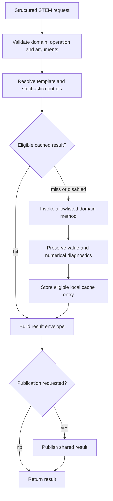

# STEM Agent System

## Overview

The STEM subsystem provides explicit mathematical, scientific, engineering, unit and uncertainty computations. [STEMAgent](../stem_agent.py) is the runtime facade: it validates structured requests, dispatches an allowlisted operation, manages local calculation caching, and optionally publishes a result to SLAI SharedMemory.

The facade inherits [BaseAgent](../base_agent.py). Its constructor is `STEMAgent(shared_memory, agent_factory, config=None, *, checkpoint_manager=None)`. The registered factory identifier is `stem`. STEM computes supplied quantitative problems; reasoning, world rollouts, optimization and formal proof remain separate subsystem responsibilities.

## Module Structure and Capabilities

| Module | Components | Implemented operations |
| --- | --- | --- |
| [stem_types.py](stem_types.py) | `Dimension`, `Unit`, `Quantity`, `PrecisionPolicy`, `Tolerance`, `NumericResult`, `SolverResult` | Scientific values, uncertainty, convergence and solver diagnostics; initial/boundary condition representations |
| [math/algebra.py](math/algebra.py) | `Algebra` | Rational values, polynomial arithmetic/division/GCD, differentiation/evaluation, quadratic roots and linear equations |
| [math/calculus.py](math/calculus.py) | `Calculus`, `Dual` | Restricted symbolic derivative/integral operations, gradients, Jacobians, Hessians, limits, Taylor series and forward-mode automatic differentiation |
| [math/numerical_methods.py](math/numerical_methods.py) | `NumericalMethods` | Linear algebra; root finding; interpolation; quadrature; Euler/RK4/adaptive RK45; bounded one-dimensional operator/PDE interfaces; numerical error diagnostics |
| [math/statistics.py](math/statistics.py) | `Statistics`, `OnlineMoments`, `OnlineCovariance` | Descriptive statistics, dependence measures, regression, distribution functions, bootstrap and Monte Carlo integration |
| [units/unit_system.py](units/unit_system.py) | `UnitSystem` | Unit lookup, prefixes, conversion, affine units, composition and compatibility |
| [units/dimensions.py](units/dimensions.py) | `Dimensions` | Dimension algebra, expression checks and Buckingham Pi support |
| [uncertainty.py](uncertainty.py) | `Uncertainty`, propagation functions | Standard/expanded uncertainty, covariance/Jacobian propagation, coverage intervals, Monte Carlo and numerical error budgets |
| [biology.py](biology.py) | `Biology` | Logistic growth, Michaelis–Menten, first-order decay, Lotka–Volterra rates and compartment balances |
| [physics.py](physics.py) | `Physics` | Kinetic energy, momentum, gravitational force, ideal-gas pressure and relativistic gamma |
| [engineering.py](engineering.py) | `Engineering`, `EngineeringQuantity` | Axial stress, one-dimensional heat conduction, electrical power and Reynolds number |
| [computer.py](computer.py) | `Computing` | GCD/LCM, factorial/binomial, recurrences, breadth-first search, Dijkstra and topological sorting |
| [stem_memory.py](stem_memory.py) | `STEMMemory` | Bounded deterministic memoization, cache identity, invalidation and serialized local state |
| [utils/temp_loader.py](utils/temp_loader.py) | Template loader | Named template resolution, loading and cache management |

The public mathematical exports come from the `math/` package. A legacy sibling [math.py](math.py) also exists; use the exports in [__init__.py](__init__.py) and `math/` for current interfaces. `Physics` and `Engineering` extend the existing Base scientific engines, but facade dispatch exposes only its explicit `_DOMAIN_OPERATIONS` allowlist, not every inherited method.

## Request and Result Contracts

`perform_task(task_data)` accepts one mapping or `{"tasks": [request, ...]}`. Use `available_operations()` to obtain the complete current domain-to-operation map; `available_operations(domain)` returns that domain's operation names.

| Request field | Contract |
| --- | --- |
| `domain` | Enabled domain name; defaults to `default_domain` |
| `operation` | Required public allowlisted operation name; private/dunder names are rejected |
| `args`, `kwargs` | Positional sequence and keyword mapping passed to the selected method |
| `request_id`, `metadata` | Optional nonempty request identifier and metadata mapping |
| `cache`, `publish` | Optional real booleans controlling this request within agent policy |
| `seed` | Optional integer, excluding booleans; stochastic operations apply their own seed rules |
| `template` | Optional named template; loading alone does not imply a scientific operation uses it |
| `template_kwarg` | Optional public keyword receiving loaded template data; must not collide with an existing keyword |
| `force_template_reload` | Request fresh template loading |

With `strict_validation=True`, unknown top-level fields fail validation. Operation arguments remain operation-specific; this is not a natural-language scientific solver. Numerical methods commonly accept Python callables and numeric sequences/arrays. Callables must be supplied in-process; JSON serialization does not recreate executable functions.

A single request returns a dictionary from `STEMResult.to_dict()` containing `request_id`, `domain`, `operation`, `result`, `cache_hit`, `cache_key`, `duration_ms`, `published`, `diagnostics`, `template`, `metadata`, and `status`. The raw result can be a scalar, array, mapping, or scientific result object. `completed_with_warning` preserves a reported non-convergence condition rather than claiming convergence. Batch execution is sequential and stops when a request raises; earlier work is not rolled back.

## Processing Workflow



Cache identity includes domain/operation, inputs, numerical controls, implementation/configuration/constant information, and applicable seed/template information. `STEMMemory` is separate from BaseAgent's SharedMemory. Seed preparation determines whether stochastic execution is eligible for deterministic caching; unseeded Monte Carlo uncertainty propagation is not cached as deterministic work. Cached execution preserves the same scientific result contract.

Templates in `templates/` are data assets. Their subject names do not add clinical, biological or other scientific capabilities to the dispatch allowlist.

## Units, Precision and Numerical Limits

`Dimension` represents exponent mappings for base dimensions. `Unit` carries scale and offset; conversion goes through the base representation. `Quantity` couples a value to a unit. `UnitSystem` checks dimensional compatibility and distinguishes affine units, including temperature offsets, from simple multiplicative units.

Scalar physics and engineering functions take numeric arguments, not universally unit-tagged quantities. Callers must provide coherent units: for example kilograms/metres-per-second produce joules for kinetic energy, and newtons/square-metres produce pascals for axial stress. These scalar methods do not automatically convert arbitrary unit-bearing inputs.

The configured precision policy specifies 12 significant digits, half-even rounding, absolute tolerance `1e-12` and relative tolerance `1e-9`. This policy is not a guarantee that every algorithm performs arbitrary-precision arithmetic. NumPy numerical paths use floating-point arrays; algebra can preserve exact `Fraction` values. Numerical solvers expose convergence, residual/error and conditioning information where implemented. Inspect it before using a value as a validated solution.

Symbolic calculus handles its supported expression subset. The one-dimensional PDE helpers discretize/apply supplied operators and boundary conditions; they are not a general multiphysics engine. Domain methods validate conditions such as positive volume/area, compatible dimensions, finite inputs and subluminal velocity where applicable.

## Configuration

Facade policy is the `stem_agent` section of [agents_config.yaml](../base/configs/agents_config.yaml), optionally shallow-overridden by the constructor/factory. Numerical configuration is [stem_config.yaml](configs/stem_config.yaml), loaded independently by the subsystem.

| Facade setting | Default | Meaning |
| --- | --- | --- |
| `enabled` | `true` | Reject computation when disabled |
| `supported_domains` | All 11 listed domains | Nonempty sequence of supported domain names |
| `default_domain` | `numerical_methods` | Must belong to enabled domains |
| `local_memory_enabled`, `cache_enabled` | `true` | Permit local deterministic cache use |
| `shared_memory_enabled` | `true` | Permit shared publication |
| `publish_shared_results` | `false` | Default per-request publication policy |
| `shared_result_key_prefix`, `shared_result_topic` | `stem:result`, `stem.results` | Nonempty publication names |
| `template_loading_enabled` | `true` | Permit named templates |
| `diagnostics_enabled`, `metrics_enabled`, `strict_validation` | `true` | Diagnostics, accounting and field validation |
| `checkpoint_local_memory`, `restore_local_memory` | `true` | Include/restore local cache through agent checkpoint state |
| `max_batch_size` | `32` | Positive batch size bound |

The facade uses boolean coercion for several configuration flags; request-level `cache` and `publish` are explicitly type-checked. Domain/default-domain validity and positive batch bounds are checked at initialization.

| Numerical section | Selected checked-in settings |
| --- | --- |
| `algebra` | `exact_rationals: true` |
| `calculus` | Hessian step `1e-5`; Taylor step `1e-4` |
| `numerical_methods` | Absolute/relative tolerance `1e-12`/`1e-9`; 200 iterations; condition warning `1e12`; ODE step `0.01`, maximum 100000 steps |
| `statistics` | `ddof: 1`, random seed `0` |
| `stem_uncertainty` | Coverage factor `2.0`, Monte Carlo samples `10000` |
| `stem_memory` | Maximum 512 entries; TTL 3600 seconds |
| `dimensions`, `unit_system` | Base/derived dimensions, SI units/prefixes, affine temperatures and compatibility policy |

## Integration and Ownership

Use `AgentFactory.create("stem", shared_memory=..., config=...)` for managed construction. The factory injects runtime services but does not train or load a STEM model. Scientific functionality is implemented by domain algorithms; no trained artifact is required by the facade's dispatch registry.

NumPy and SciPy are used by numerical/statistical modules. Base scientific engines, shared configuration and logging add their existing runtime dependencies. Importing the package therefore has a broader dependency surface than a single scalar equation might suggest.

Checkpoint hooks expose agent-owned metrics and local state through BaseAgent. They do not replace the external checkpoint manager or serialize shared services as local scientific data. `reset_local_state(clear_memory=True, reset_metrics=True)` is an explicit local reset; it is not a request to erase global SharedMemory.

## Minimal Usage

Run from the repository root in the configured SLAI environment:

```python
from src.agents.agent_factory import AgentFactory

factory = AgentFactory()
try:
    agent = factory.create("stem", config={"publish_shared_results": False})
    response = agent.perform_task({
        "domain": "physics",
        "operation": "kinetic_energy",
        "kwargs": {"mass": 2.0, "velocity": 3.0},
    })
    assert response["result"] == 9.0
    print(response["diagnostics"])
finally:
    factory.shutdown()
```

Direct scientific use retains the subsystem's dependency and configuration requirements:

```python
from src.agents.stem import UnitSystem

units = UnitSystem()
converted = units.convert(0.0, "°C", "K")
assert abs(converted - 273.15) < 1e-9
```

## Error Handling and Implementation Status

Unsupported domains/operations, malformed request fields and invalid arguments raise `STEMValidationError` or more specific STEM errors. Disabled execution raises `STEMConfigurationError`. Domain errors preserve their STEM taxonomy; argument `TypeError` becomes `STEMValidationError`, while other unexpected calculation exceptions are wrapped as `STEMError`. A numerical warning/result is distinct from a raised failure.

Direct `perform_task()` does not apply BaseAgent retry/recovery. Shared publication uses `set()` (or `put()`) and an optional `publish()` call. These calls are not guarded in `_publish_result()`: a publication exception can propagate after the calculation has completed. A successful calculation must therefore not be equated with a successfully returned or persisted request. There is no general theorem prover, unrestricted computer algebra system, model-training pipeline or automatic simulation/optimization loop in this facade.

## Testing and Verification

The repository contains an embedded STEM facade demonstration in [stem_agent.py](../stem_agent.py), including numerical, cache, template and checkpoint checks. It requires the configured runtime and can exercise persistence. The files under [docs/](docs/) contain historical grounding and validation material; they are not evidence of a test run on a different checkout.

There is no dedicated STEM test suite under `tests/` in this checkout. Run the examples above as focused smoke checks after satisfying existing dependencies. For a non-importing syntax check from the repository root:

```bash
python -c "import ast,pathlib; [ast.parse(p.read_text(encoding='utf-8')) for p in pathlib.Path('src/agents/stem').rglob('*.py')]; ast.parse(pathlib.Path('src/agents/stem_agent.py').read_text(encoding='utf-8'))"
```

Syntax checks do not verify numerical accuracy. Validate scientific calculations against known values, domain assumptions and convergence diagnostics before using them in downstream analysis.

## Related Documentation

- [Agent architecture](../README.md), [Factory](../factory/README.md), [Base runtime](../base/README.md)
- [Spatial](../spatial/README.md), [Simulation](../simulation/README.md), [Optimization](../optimization/README.md)
- [Scientific grounding](docs/STEM_ACADEMIC_GROUNDING.md)
